<p align="center"><a href="README.md">English</a> | <a href="README.ru.md">Русский</a></p>

# RetroPair

<p align="center"><strong><a href="https://retropair.dev/en?utm_source=github&amp;utm_medium=referral&amp;utm_campaign=plugin_readme&amp;utm_content=readme_en">Website &amp; demo ↗ retropair.dev</a></strong></p>

**Review the pair. Improve the human.**

**A retro on how you work with AI coding agents — not a review of the code they write.**

Human–AI Collaboration Retrospectives: evidence-based coaching for developers working with AI coding agents.

Your sessions reveal how you work. RetroPair shows you how to improve.

RetroPair is a Claude Code plugin that reads your agent session logs for a period and tells you how you lead the agent: how you frame tasks, verify results and keep decisions in your hands. Eight behaviour axes, each judgement backed by a verbatim quote from the log, one to three concrete next steps, a check of those steps in the next period, and progress against your own previous period. People are never compared with each other.

[Product website](https://retropair.dev/en?utm_source=github&utm_medium=referral&utm_campaign=plugin_readme&utm_content=readme_en) · [Plugin repository](https://github.com/Serg1kk/retropair) · Version **0.2.0**

[](LICENSE)
[](CHANGELOG.md)
[](#quick-start)
[](#quick-start)

<p align="center">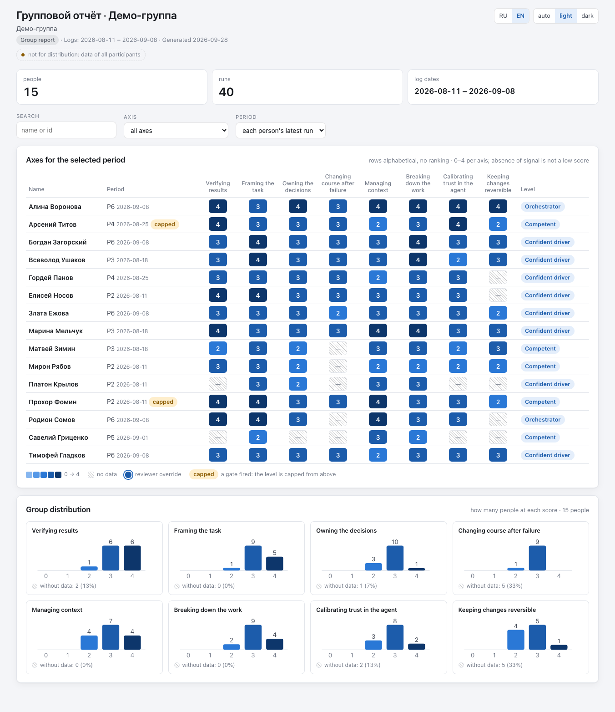</p>

<sub>All screenshots are taken on the anonymized demo workspace that ships with the plugin (fictional names; the demo review texts are in Russian, the interface switches between English and Russian).</sub>

**Contents:** [Who it is for](#who-it-is-for) · [Quick start](#quick-start) · [How it works](#how-it-works) · [The full cycle](#the-full-cycle) · [The eight axes](#the-eight-axes) · [How a score is given](#how-a-score-is-given) · [Next steps and the follow-up loop](#next-steps-and-the-follow-up-loop) · [Personalization](#personalization) · [Reports](#reports) · [Collecting logs](#collecting-logs) · [Privacy](#privacy) · [Configuration](#configuration) · [Cost, time and quality](#cost-time-and-quality) · [Demo](#demo) · [FAQ](#faq) · [How it differs](#how-it-differs) · [Documentation](#documentation) · [Roadmap](#roadmap) · [Contributing](#contributing)

## Who it is for

| Mode | Who reviews whom | People | Text to the person |
|---|---|---|---|
| `self` | you review yourself | one card, `me` | ready at once: you are the reviewer |
| `team` | a team lead or reviewer reviews the team | a card per person | a draft until the reviewer approves it |
| `course` | an instructor reviews a learning group | a card per participant | a draft until the instructor approves it |

One codebase for all three; the mode is chosen in `setup` and can be changed by running it again.

What you get:

- **Sanitized logs in one place**: Claude Code sessions directly, other agents (Cursor, Codex, Antigravity and others) through SpecStory exports, plain folders and, in team and course modes, git repositories. Secrets, e-mails, home-directory logins and the names you list are removed before anything is copied; your original logs are never modified.
- **An assessment on eight axes** of how you lead the agent, each score standing on a verbatim quote with the session and turn. No signal means "insufficient data", not a low score.
- **A personal text** with one to three next steps: where in the log, what it cost, what to try instead. Next period the judge checks each step against the new logs.
- **Wording tuned to the person**: form of address, length, tone, what not to explain, hard limits. The card changes the wording, never the score.
- **Self-contained HTML reports**: for the reviewer (everything, including the "kitchen"), for the group (no ranking) and a personal file to send to a person. They open in any browser without a network.

## Quick start

You need Claude Code and python3 3.10 or newer (standard library only, nothing to `pip install`). SpecStory is optional: it is only needed to collect logs of other agents.

In Claude Code:

```text
/plugin marketplace add Serg1kk/retropair
/plugin install retropair@retropair
/retropair:setup
```

- After installing, run `/reload-plugins` or start a new Claude Code session, then call `/retropair:setup`.
- Developing the plugin: `claude --plugin-dir <path to plugin>` runs it from a local folder without installing.

`setup` asks up to 11 questions one at a time and creates the workspace `.retropair/` in your project. Then ask Claude Code to "collect my logs" and "run the retro", and open the reports: [the full cycle](#the-full-cycle) below walks through every step.

Already using SessionRetro? Read the [migration guide](docs/en/migration.md) before setup: the new workspace is `.retropair/`; migration previews changes and refuses conflicting old/new directories. `scripts/rp.py` is the preferred CLI; `scripts/sr.py` remains supported for existing scripts.

## How it works

<p align="center">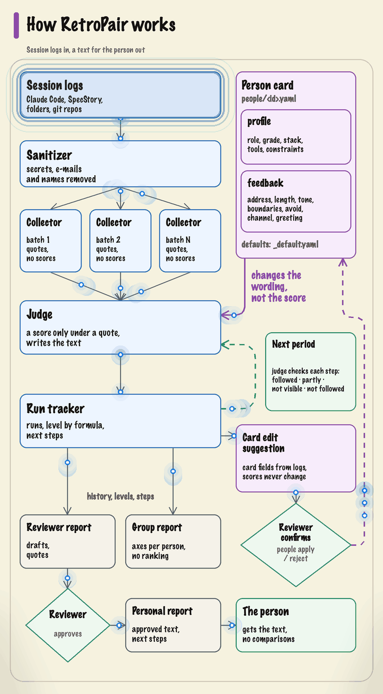</p>

The person card goes to the judge only: it changes the wording, not the score. The judge checks each period's next steps in the next period, and in team and course modes a text reaches the person only after the reviewer approves it. After an approved run the plugin may propose card edits; the card changes only when the reviewer runs `people apply`.

<details>
<summary>Text version</summary>

```text
session logs ─▶ sanitizer ─▶ collectors ─▶ judge ─▶ run tracker ─▶ HTML reports
                             (batches,      (scores     (history,
                              quotes,        under       levels,
                              no scores)     quotes,     next steps)
                                             text)
                                             ▲
person card: profile + feedback ─────────────┘  changes the wording, not the score

next period: the judge checks each next step ─▶ followed · partly · not visible · not followed
reviewer report ─▶ the reviewer approves (team, course) ─▶ personal report ─▶ the person
run tracker ─▶ card edit suggestion ─▶ the reviewer confirms (people apply / reject) ─▶ person card
               (card fields from logs; scores never change)
```

</details>

Scripts collect the logs and sanitize them. Collector agents read a period's sessions in batches in parallel and write down verbatim quotes, without scores; nothing is cut, a batch is a split, not a sample. One judge agent combines the facts, scores each axis only under a quote and writes the parts of the text. Scripts check the result, record the run, compute the level by formula and render the text with a replaceable template. Details: [docs/en/how-it-works.md](docs/en/how-it-works.md).

## The full cycle

Every step is a skill you can call by name or just ask for in your own words; the same steps are plain `rp.py` commands for scripts and CI (`python3 "${CLAUDE_PLUGIN_ROOT}/scripts/rp.py" <command>`).

| Step | Command | What happens | What appears |
|---|---|---|---|
| 1. Setup | `/retropair:setup` | up to 11 questions (mode, people, log sources, SpecStory, hook, models, scores, periods, template, log retention, `.gitignore`), then `setup-apply` applies the answers and `doctor` shows the result | `.retropair/config.json`, `people/_default.yaml`, `people/<id>.yaml`, project agents `.claude/agents/retropair-*.md` with `agents.json`, an entry in `~/.retropair/workspaces.json` |
| 2. Collect | `/retropair:collect`, or automatically by the SessionEnd hook | sources are read, every log passes the sanitizer, copies land in the workspace, the inventory gets statuses (new, grown, unchanged, duplicate, gone, excluded) | `logs/<id>/…`, `logs-index.json`, `collect.log` (hook) |
| 3. Review | `/retropair:review <person>` or `--all` | project agents synced; the period's sessions split into batches; collectors run in parallel; `check-collector` verifies every quote against the log; the judge scores and writes; `append` records the run; `level` computes the level; `render-review` builds the text; `verify` checks everything is closed | `runs/pending/<person>/batch-NN.json` and `judge.json`, the history `runs/process-reviews.json`, the text `reviews/<person>/<run_id>.md` |
| 4. Approve | `/retropair:review --approve <person>` or `rp.py approve <person>` | team and course: the reviewer reads the draft and approves it; from this moment its next steps count as received. The skill then runs `people suggestions <person> --refresh`; the bare `rp.py approve` only changes the status, so run that command yourself after it | `status: approved` in the review file, `approved_at` in the run; card suggestions `people/<id>.suggestions.json` (after `--refresh`) |
| 5. Report | `/retropair:report` | HTML reports are rebuilt from the history; a personal file is refused if it mentions other people | `reports/reviewer.html`, `reports/group.html`, `reports/personal/<id>.html`, `~/.retropair/reports/index.html` |
| 6. Next period | collect and review again | only new sessions and the new tails of grown ones are assessed; the judge gives a verdict on every open next step from earlier periods | a new run; verdicts in the recommendation history of every report |

<details>
<summary>What the review skill does inside, step by step</summary>

1. Finds people with new or grown sessions; no new logs means no review of that person and no conclusion about them.
2. Runs `agents sync`: unedited project agents are updated to the current plugin prompts, edited ones are left alone with a reminder.
3. Splits the period into batches by start time (`batches`): every usable session goes into exactly one batch; sessions with fewer than `batches.min_turns` (4) of your messages are marked "too short" and not fed again until they grow.
4. Starts one collector per batch, in parallel. Collectors never see the person card or past scores.
5. `check-collector` checks each output: no scores, all eight axes present, every quote found in the named turn as your message or a tool call, not the agent's words. A shifted turn is fixed automatically with a warning; after two restarts unverifiable quotes are dropped and the axis gets "insufficient data" with the reason "quotes did not match the log".
6. The judge combines all batches, scores under quotes, gives verdicts on open recommendations and writes the parts of the text.
7. `append` validates and records the run (a score without a quote, a level above the gate ceiling or a forbidden word in the text is code `1` and a judge restart); `mark-logs` closes the session marks; `level` computes the level; `render-review` builds the text.
8. In team and course, without `--no-ask`, the text can go through the critic agent, whose notes are shown to the reviewer.
9. `verify` must be green: every run has its marks, text and level.
10. The summary per person: sessions assessed and excluded, text status and path, warnings, pending card suggestions with ready `people apply` / `people reject` commands. The skill never applies them itself.

`--no-ask` runs without a single question (for `claude -p`), `--task-summary "…"` gives one neutral line about the work. Walkthrough, arguments and exit codes: [docs/en/review.md](docs/en/review.md); the assessment in plain words: [docs/en/how-it-works.md](docs/en/how-it-works.md).

</details>

## The eight axes

| Axis | What is observed | Stronger | Weaker | Never penalised |
|---|---|---|---|---|
| **Verifying results** (counts twice in the level) | whether verification is part of the task and the result is accepted on evidence | the definition of done is named before the work; the check is run and its output read; the whole diff is reviewed | "all tests passed" taken without the output; the next task right after "done" | no tests on a project without tests; a check in another terminal that the log does not show |
| **Framing the task** | what went into the prompt before the agent started, and when | a fact the agent cannot learn from the repo, file references, one task, targeted limits, a plan before multi-file work | five tasks in one message; limits pieced together after "remove that, I didn't ask" | where the prompt came from (copied, found, generated); limits kept in the project rules file |
| **Owning the decisions** | whether the person stays the author once the agent writes code | questions about mechanics, refusal with a reason, objection to an architectural move, reaction to a warning | a schema accepted silently; "up to you" on a product question | how often the person steps in: a short "yes" after a frame set in advance is ownership |
| **Changing course after failure** | what happens when the result does not fit | each attempt brings a new fact; after the second failure the lever changes; a failed change is rolled back | the third "fix it" with no new fact; patch over patch | the number of iterations; irritation, caps lock, exclamation marks |
| **Managing context** | what fills the window, what goes into files, what happens when it swells | the agent relies on project rules; files supplied in a targeted way; the outcome saved before a reset; the task restated after compaction | topics mixed in one session; an unnoticed auto-compact | the quality of the rules file itself; numeric rules when the tool does not report window usage |
| **Breaking down the work** | how work is sliced and where each piece goes | one task per round; a check and a commit between tasks; independent pieces in their own contexts | everything in one prompt, or dictating keystrokes without a definition of done | the number of pieces as such: slicing for its own sake earns nothing |
| **Calibrating trust in the agent** | whether trust follows the cost of a mistake | a migration or production data treated differently from a rename; a branch or a test database prepared; the reason not to check said out loud | the same trust for a rename and a deletion | not checking a cheap, reversible change when the reason is said ("throwaway, not looking") |
| **Keeping changes reversible** | how cheap it is to undo a bad move | a return point before a run; steps the size of one unit of work; risky work in a branch; a bad result thrown away whole | no return point, so a failure is fixed on top; starting on a dirty tree | the number of commits; branches on a small solo project; versioning not visible in the log ("insufficient data", not zero) |

Never assessed at all: code quality, architecture, completeness of the solution, polish of the wording, message length, speed, voice input. The axes, the gate and the 42 anti-patterns in detail: [docs/en/axes.md](docs/en/axes.md).

## How a score is given

| Rule | What it means in practice |
|---|---|
| **Batches, not samples** | a period with many sessions is split into batches by time and every usable session is read; a session is never split between batches; batch size is counted by your messages, so long tool traces take no room |
| **Two stages, always** | collectors write down quotes without scores; one judge combines all batches and scores. The same path for everyone, so growth shows up as growth, not as a different way of counting |
| **A score only under a quote** | each axis gets 0–4 only with a verbatim quote and its address (session and turn); a script rejects a score without one. Frequency is counted across batches, so a single episode does not sink an otherwise even picture |
| **"Insufficient data" is not a failure** | if the behaviour is not visible in the log, the axis gets "insufficient data" with one of nine reasons (log too short, work outside the log, tool leaves no trace, quotes did not match the log…). It never turns into a low score; a low score needs positive evidence |
| **The level is a formula** | a script takes the median of the scored axes, verifying results counted twice: from 3.5 Orchestrator, from 2.75 Confident driver, from 2.0 Competent, from 1.0 Naive, below that Passenger; fewer than three scored axes is "insufficient data". The judge's own level is only a cross-check |
| **The gate is a ceiling, not a zero** | six triggers that are visible in the log (blind acceptance of a large change, a product choice left to the agent, a warning ignored, a "done" report taken without a check, stated confusion left unresolved, no stance over a long session): one caps the level at Competent, two or more at Developing. Silence never triggers the gate |
| **What the judge never gets** | past scores and levels, the reviewer's impressions, acceptance criteria of the task, the code itself, project rules files, other people's logs |
| **The critic** | in team and course, without `--no-ask`, a separate agent reads the draft text and its notes go to the reviewer |
| **The reviewer's correction** | a run can carry `operator_override` (axes with new scores, `why`, `by`, `at`) in the run history: the level is computed with it, reports mark the score "reviewer override", and it survives a re-assessment with `append --replace`. There is no dedicated command for it in 0.2.0; a wrong run as a whole is retracted with `rp.py retract <run_id> --why "…"` |

## Next steps and the follow-up loop

Every text has one to three "try differently" items. Each item is built from the judge's fields: the date and place in the log, a verbatim quote, what it cost, a concrete action for the next session and, in detailed texts, up to two neighbouring techniques. Each action is a recommendation with its own id (`REC-<person>-NNN`) in the run history.

Next period the judge looks for each open recommendation in the new logs and gives one of five verdicts:

| Verdict | Closes the recommendation? |
|---|---|
| Followed | yes, status "Followed" |
| Not followed | yes, status "Not followed" |
| Partly followed | no, it stays open |
| Not visible in the logs | no, it stays open: "not visible" does not mean "ignored" |
| Too early to judge | no: every log of the period ended before the person received the recommendation |

A recommendation is judged only on logs recorded after the person received it: the run time in self mode, the approval time in team and course. While a text is a draft, its recommendations are not asked about. Every report with recommendations (the reviewer's, the personal one, the group one with person cards) shows the history under each recommendation, from the oldest period to the newest (for example "P4 ◐ Partly followed · P5 ◐ Partly followed · P6 ◐ Partly followed"), with the judge's explanation in a tooltip; a recommendation not checked yet says so.

<p align="center">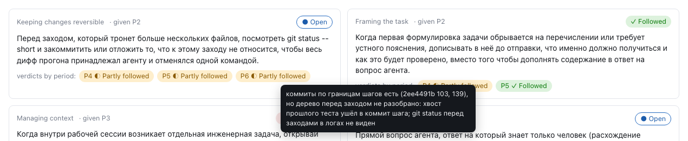</p>

`rp.py open-recs <person>` lists the open recommendations; `rp.py compare <run_a> <run_b>` compares two runs of the same person.

## Personalization

Every person has a card `.retropair/people/<id>.yaml` (in self mode `me.yaml`); shared text defaults live in `.retropair/people/_default.yaml`, and a card overrides only the fields it lists. The card is validated on every read: an unknown value (for example `tone: soft`) is code `1` with the field name.

```yaml
id: "alex"
name: "Alex"
group: team-a
profile:
  role: backend developer
  grade: middle
  years: 4
  stack: Python, Postgres
  tools: Claude Code
  constraints: no access to production
feedback:
  address: you
  length: short
  tone: supportive
  skip_basics:
    - what git is
  boundaries:
    - do not suggest cloud services
consent:
  logs: true
  date: 2026-09-01
```

**The card changes the wording, not the score.** The same log gets the same score for an architect and for a beginner; "senior, so we expect more" and "beginner, so we forgive" are both forbidden. Collectors never see the card at all, and the text never retells it ("as a senior with nine years of experience" is not written). To see exactly what the judge gets: `rp.py people context <id>`.

<details open>
<summary><b>profile</b>: who the person is (all fields optional, empty by default)</summary>

| Field | Example | How it changes the text |
|---|---|---|
| `role` | `backend developer` | picks the register of the wording together with `grade` and `years` |
| `grade` | `senior` | the same advice sounds like a step for a beginner and like a pointer for someone who teaches it to others |
| `years` | `4` (integer) | same as `grade` |
| `stack` | `Java, Kotlin, Postgres` | examples fit what the person works with |
| `tools` | `Claude Code, Cursor` | explains missing traces (a tool without a terminal trace → "insufficient data" with a reason, not a low score) and cuts impossible advice ("start a new session" in Cursor instead of a command it does not have) |
| `constraints` | `closed network, no rights to production` | same as `tools`: advice the environment does not allow is dropped |

</details>

<details open>
<summary><b>feedback</b>: how to write to the person (defaults from <code>_default.yaml</code>)</summary>

| Field | Values | Default | Used by | How it changes the text |
|---|---|---|---|---|
| `address` | `ты` · `вы` · `you` | `ты` | judge + check | one form of address for the whole text (`ты`/`вы` are the informal and formal Russian "you", `you` is for English); for `ты` and `вы`, `render-review` refuses a text whose form of address does not match; `you` is not checked by the script |
| `length` | `short` · `detailed` | `detailed` | judge + check | `short`: a one-sentence opening, at most two items, no neighbouring techniques, one phrase per axis; `detailed`: up to three items, up to two techniques each, up to two sentences of evidence per axis. The script checks the number of items, the techniques in `short` and one phrase per axis in `short`, and refuses rather than trims; the one-sentence opening and the evidence limit in `detailed` are instructions to the judge |
| `tone` | `direct` · `supportive` | `direct` | judge | `supportive` adds one closing line that pins down a steady technique with its date and place; `direct` has no closing. Praise is forbidden in both |
| `opening_summary` | `true` · `false` | `false` | judge | `true`: after the coverage line, two or three plain sentences "what is visible and what to change first" |
| `mark_sections` | `true` · `false` | `false` | judge | `true`: one navigation sentence in the opening, "first what to change, below what it stands on" |
| `practices` | `true` · `false` | `true` | judge + check | `false`: no neighbouring techniques at all; the script refuses a text that has them |
| `skip_basics` | list | empty | judge | what the person already knows is not presented as a discovery, only as the place where they departed from their own practice |
| `boundaries` | list | empty | judge | **a hard ban, not a wish**, on recommendations and techniques ("do not carry advice over to the work stack"); an item that breaks it is replaced by the next one by cost |
| `avoid` | list | empty | judge | a hard ban on the text itself: words, topics, ways of putting things |
| `value_focus` | `finding` · `full` | `finding` | judge | `finding`: items only about findings of this run; `full`: also about even spots where a cheaper way exists |
| `show_dynamics` | `true` · `false` | `true` | judge + report | `true`: the verdict on last period's recommendation for the same axis is mentioned in one phrase; in the "dynamics only" report view the transitions are shown only when `true` |
| `show_scores` | `true` · `false` | not set (from `config.json`) | report | the personal report view: scores and level, or dynamics only ↑ → ↓ ◇. Not given to the judge |
| `channel` | `file` · `telegram` · `slack` · `email` | `file` | nobody yet | stored and validated; not given to the judge, and in 0.2.0 the renderer produces the same markdown for every channel |
| `template` | `default` · `workspace` · file name | `default` | renderer | which template lays out the text (below) |
| `prefix` | string | `""` | renderer | a line before the text, for example a greeting; empty means no line |

</details>

**Text template.** The template only lays out the text: the order of parts, the greeting, a signature. It has exactly five placeholders in double curly braces: `prefix`, `opening`, `actions`, `criteria`, `closing`. Get an editable copy with the "own copy" answer in `setup` (it lands in `.retropair/templates/feedback.md`) and set `template: workspace`; keep several templates side by side and pick one per card with `template: short.md`. A missing template file stops rendering with code `1` and the path it looked for; there is no silent fallback. Details: [docs/en/customize.md](docs/en/customize.md).

### One judge output, two cards

What actually happens when the card changes, shown on the demo workspace: the same recorded judge output of one demo participant (run `P6`) rendered twice with `render-review` in a temporary copy of the demo, first with the participant's own card, then with a different one.

<table>
<tr><th>Card A (the demo card)</th><th>Card B</th></tr>
<tr><td>

```yaml
feedback:
  address: ты
  length: detailed
  tone: supportive
  opening_summary: true
  prefix: "Привет!"
```

</td><td>

```yaml
feedback:
  address: вы
  length: short
  tone: direct
  opening_summary: false
  prefix: "Добрый день!"
```

</td></tr>
<tr><td>

The text is written, exit code `0` (excerpt, lines wrapped):

```text
Привет!

Разобрано сессий: 5, ходов: 788.

**Если читать быстро: что попробовать иначе.**

**Первое.** Стоит попробовать: Когда сверка
по чек-листу возвращает список расхождений,
вести его как список дефектов: …

**Второе.** Стоит попробовать: Начиная со
второго вывода той же поломки, дописывать к
выводу терминала одну фразу: что, по-твоему,
сломалось и что уже исключено, …
```

</td><td>

Nothing is written, exit code `1` (lines wrapped):

```text
retropair: текст ревью
demo-course_p02_P6_20260921T201000Z не записан,
нарушены запреты (1):
  обращение 'твоему' при address: вы
```

"The review text was not written, rules broken (1): form of address 'твоему' (informal) while `address: вы` (formal)."

</td></tr>
</table>

What this shows, honestly: the script does not reword anything. It adds the `prefix`, lays the parts out with the `template` and enforces the card: a text written for `ты` cannot go out to a `вы` card, a text with three items cannot go out to a `short` card. The wording for card B is written by the judge in the next run, which gets card B's slice (`rp.py people context p02` prints it). The demo texts are in Russian, and error messages are printed in Russian in 0.2.0.

### Card suggestions

After an approved run RetroPair compares the card with what the logs show and proposes edits. It never changes the card by itself: an edit reaches the file only through `people apply`. Suggestions are recomputed by `people suggestions --refresh`; the `review` skill runs it at the end of a run and after `--approve`. The bare `rp.py approve` only changes the status, so after it run `rp.py people suggestions <person> --refresh` yourself.

| Source | What is proposed |
|---|---|
| tools in the logs | agents and models of the latest approved run missing from `profile.tools` (build numbers dropped, duplicates merged) |
| steadily strong axes | axes scored 3 or higher in the two latest approved periods → add them to `feedback.skip_basics`; an axis once proposed (even rejected) is not proposed again |
| the judge | a `profile` field that the logs contradict (stack, tools, environment limits), with a reason and a quote; only the latest approved period counts |

Never proposed: scores, levels, the review text, and the `feedback` fields tone, length and channel; those are edited by hand only.

```bash
python3 "${CLAUDE_PLUGIN_ROOT}/scripts/rp.py" people suggestions --refresh          # recompute from approved runs
python3 "${CLAUDE_PLUGIN_ROOT}/scripts/rp.py" people suggestions alex --all         # with applied and rejected ones
python3 "${CLAUDE_PLUGIN_ROOT}/scripts/rp.py" people apply alex S-alex-001
python3 "${CLAUDE_PLUGIN_ROOT}/scripts/rp.py" people reject alex S-alex-002 --reason "my call"
```

`apply` changes one line (or adds list items) and keeps the comments and order; if the card then fails validation, the file is restored and the exit code is `1`. A suggestion whose field was edited by hand in the meantime is closed as `stale` by `--refresh`. Suggestions are stored next to the card in `people/<id>.suggestions.json` (field, old and new value, reason, run, status `pending` / `applied` / `rejected` / `stale`); pending ones are shown in `reviewer.html` with ready commands and counted by `doctor` (`card_suggestions_pending`). They never appear in the personal file or in `group.html`.

<p align="center">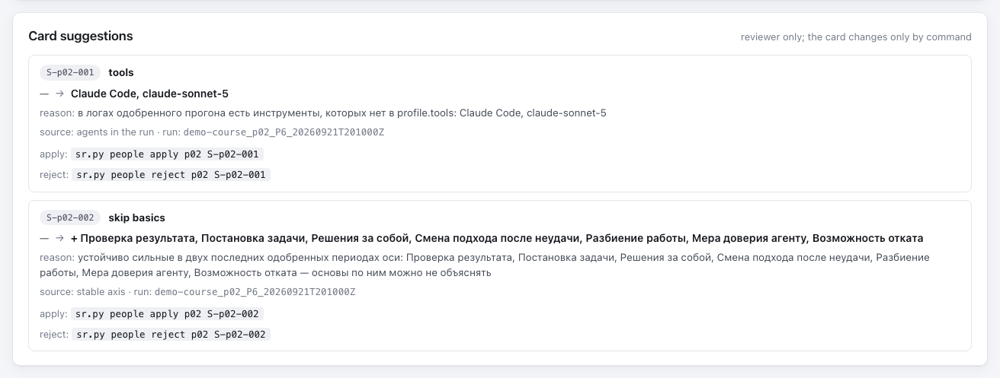</p>

## Reports

`/retropair:report` (or `rp.py report`) builds self-contained HTML files. Everything a file shows is inside it, so each file is built from a whitelist of what its reader may see: what is cut is absent from the file, not hidden in the browser.

| File | For whom | What is inside |
|---|---|---|
| `reports/reviewer.html` | the reviewer (in self mode, you) | everything: overview, every person's card, axes over time with the judge's explanations, evidence quotes, anti-patterns, flags, drafts and approved texts, dossiers, recommendations, card suggestions, an "As the person sees it" switch |
| `reports/group.html` | the reviewer, a team lead, an instructor (team and course) | approved runs only: the heatmap "people × axes" in alphabetical order with filters by name, axis and period, the distribution per axis; a click on a row opens the person's card: axes over time, approved texts by period (with an "all" tab), recommendations with verdict history. A "not for distribution" badge on top |
| `reports/personal/<id>.html` | the person | their card as the reviewer sees it, minus everything reviewer-only |
| `~/.retropair/reports/index.html` | you | all your workspaces with links to their reports |

<details>
<summary>Gallery: group card, personal report, texts, recommendations, workspaces page, dark theme</summary>

**Group card.** A click on a row of the heatmap: charts, "Feedback by period" with the "all" tab and the recommendations with their verdicts.

<p align="center">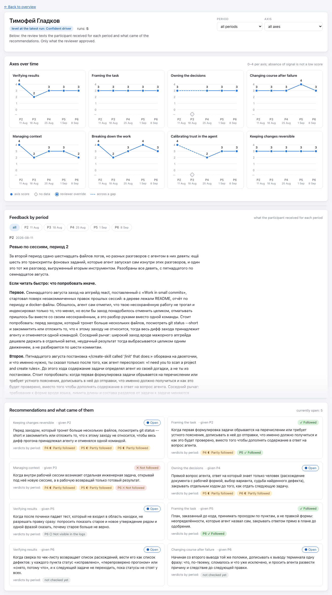</p>

**Personal report, dynamics only view** (`--trend`): the same card without scores and level, a transition per period: ↑ better, → same, ↓ lower, ◇ no data.

<p align="center">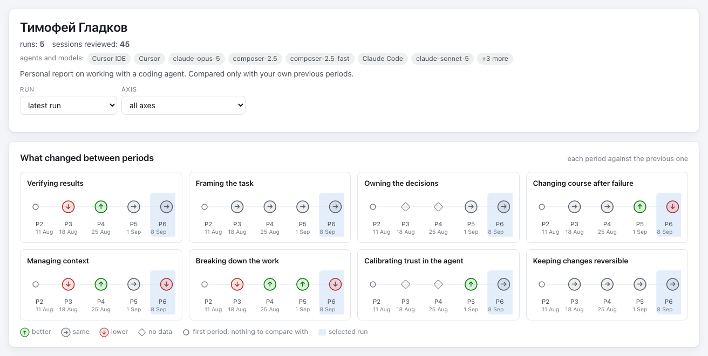</p>

**Review texts by period.** Only texts the reviewer approved, the part that is sent; the "all" tab shows them in a row.

<p align="center">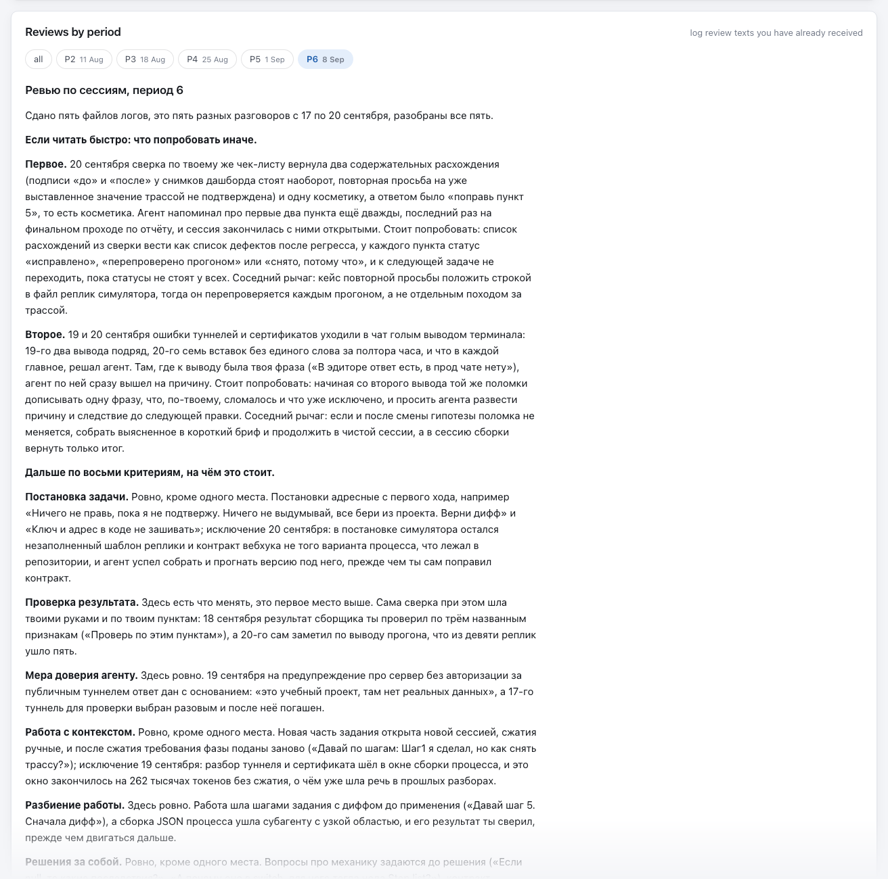</p>

**Recommendations and what became of them.** Status and a verdict chain per recommendation.

<p align="center">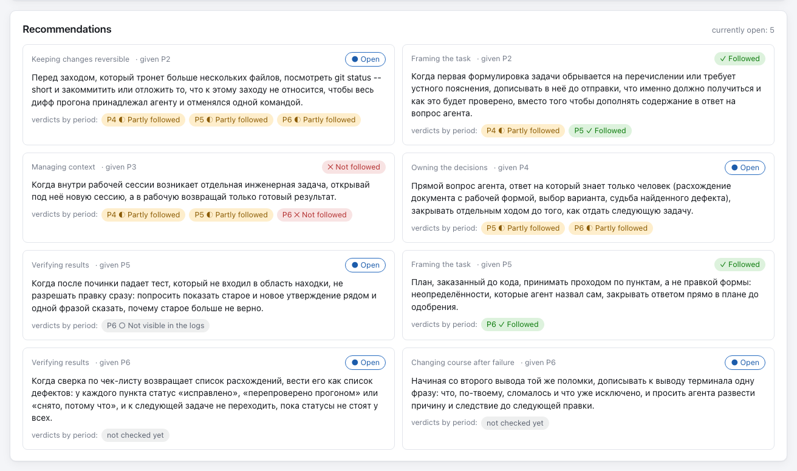</p>

**All workspaces on one page.**

<p align="center">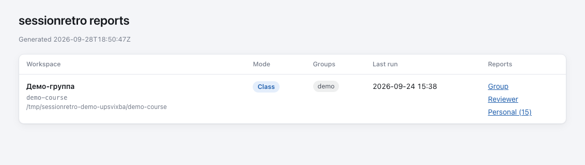</p>

**Dark theme** (auto, light and dark switch in every report).

<p align="center">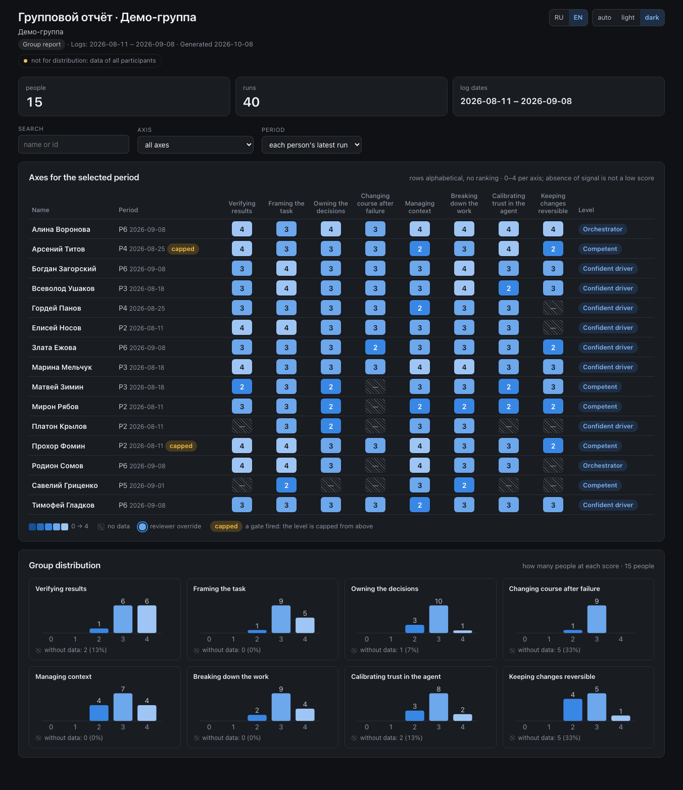 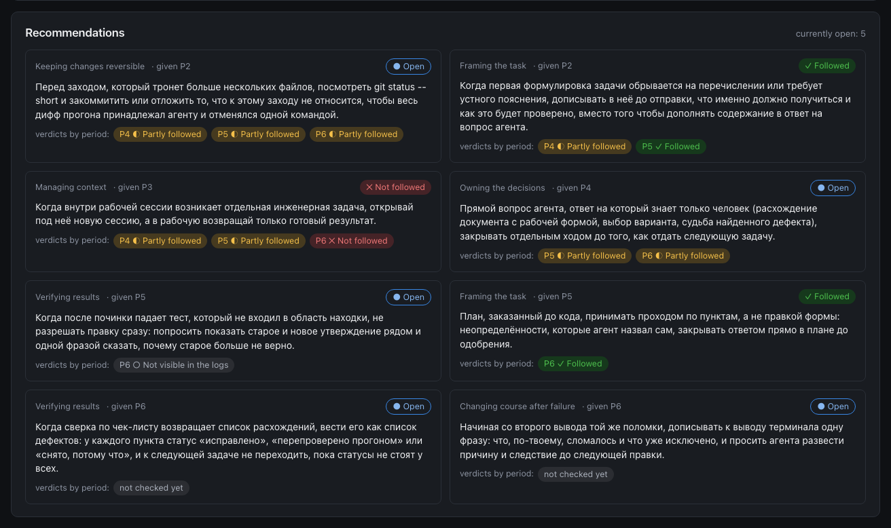</p>

</details>

### What only the reviewer sees and what both see

The same demo participant, the latest period: on the left the reviewer's card, on the right the personal file as the person receives it (the reviewer gets the same view with the "As the person sees it" button).

<table>
<tr><th>Reviewer: <code>reviewer.html</code></th><th>The person: <code>personal/&lt;id&gt;.html</code></th></tr>
<tr><td>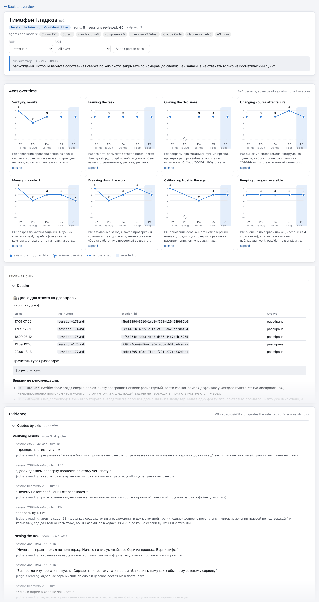</td>
<td>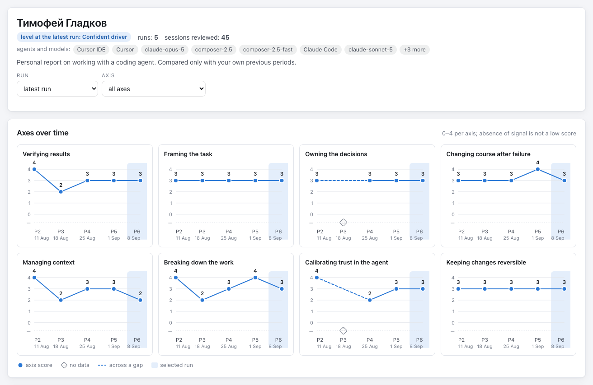</td></tr>
</table>

| Block | Reviewer | Personal file | `group.html` | Why |
|---|:---:|:---:|:---:|---|
| Axes over time (charts) | ✅ | ✅ scores, or ↑ → ↓ ◇ in the trend view | ✅ | the person's own progress |
| Level at the latest run | ✅ | ✅ in the scores view, ❌ in trend | ✅ in the heatmap | same rule as scores |
| Agents and models used | ✅ | ✅ | ❌ | context for the person |
| Approved review texts (the part that is sent) | ✅ | ✅ | ✅ | the person has already received them |
| Recommendations with verdict history | ✅ (plus those from drafts, marked) | ✅ approved runs only | ✅ approved runs only | the follow-up loop |
| The judge's explanations under the charts | ✅ | ❌ | ❌ | working notes of the assessment |
| Run summary ("main thing of the run") | ✅ | ❌ | ❌ | a service line for the reviewer |
| Evidence: quotes by axis with session and turn | ✅ | ❌ | ❌ | raw log excerpts stay with the reviewer |
| Dossier: sessions, files, ids, commands to open a log piece | ✅ | ❌ | ❌ | for answering "where was that?" |
| Anti-patterns, safety flags, gate evidence | ✅ | ❌ | ❌ ("capped" badge only) | labels are for the reviewer, the person gets actions |
| Drafts and unapproved runs | ✅ marked "draft" | ❌ | ❌ (not in the heatmap and charts either) | only the reviewer sees what is not approved yet |
| Service header of the review file, log paths | ✅ | ❌ (machine paths in verdict notes are cut: a path inside the workspace becomes `logs/<id>/<file>`, any other becomes a file name) | ❌ | machine paths and bookkeeping |
| "Reviewer override" mark | ✅ | ❌ (the final score is shown) | ✅ marker | the person sees the result, not the correction |
| Card suggestions | ✅ | ❌ | ❌ | the card is the reviewer's tool |
| Other people's data | ✅ | ❌ never | ✅ (it is the group view) | a personal file is about one person |

<details>
<summary>Scores or dynamics only: how the personal view is chosen</summary>

A personal report has two views: **scores** (the default: charts with scores 0–4 and the level, like the reviewer's card) and **trend** (transitions ↑ → ↓ ◇ between periods, no scores and no level, not even in the file's data). The first setting that is present decides:

1. the run flag `--scores` or `--trend` (the old names `--show-scores` and `--hide-scores` still work); two view flags at once is code `2`;
2. `feedback.show_scores: true | false` in the person card (or in `_default.yaml` for everyone);
3. `show_scores` in `.retropair/config.json` (`true` after `setup`).

When personal reports are built, the `/retropair:report` skill asks once "Scores or dynamics only?" and passes the answer as a flag; with `--no-ask` the view comes from the cards and the config. There are never scores in the review text itself.

</details>

<details>
<summary>Group report switches: <code>--no-details</code>, <code>--anon</code></summary>

- `--no-details` (with `--group`) or `"report": {"group_details": false}` in `config.json`: the group report without the person card, numbers and charts only; use it to hide the feedback texts and recommendations from `group.html`.
- `--anon`, best with `--out-dir <folder>` (without it the anonymized files land in `.retropair/reports/` next to the regular ones): an anonymized copy for a demo, an article or an issue. Ids become codes (`p01`…), names become made-up ones, e-mails, profile links, handles and home paths are removed; a file that still contains a real name or id is not written (code `1`).
- `group.html` is not written without `--anon` if it contains a word from `sanitize.names`: the old file is deleted, code `1`.

</details>

**Sending a personal file.** Approve the text (drafts never reach the personal file), build with `rp.py report --personal alex`, open `reviewer.html` and press "As the person sees it" to check, then send `reports/personal/alex.html` by any channel you like. It is one self-contained file with no external scripts or fonts; the recipient installs nothing. Before writing it, the command checks it for names and ids of other people in the workspace and for words from `sanitize.names`: if anything is found, that file is not written, the old one is deleted and the exit code is `1`. The plugin never sends anything by itself.

Full page: [docs/en/reports.md](docs/en/reports.md).

## Collecting logs

`/retropair:collect` (or `rp.py collect`) reads the sources from `config.json` and the person cards, passes every log through the sanitizer and writes copies to `.retropair/logs/`. It is safe to repeat: originals are never changed, unchanged copies are not rewritten.

| Source type | What it reads | Settings |
|---|---|---|
| `claude-jsonl` | Claude Code sessions: `*.jsonl` in `~/.claude/projects/<project folder>/`, with subagent sessions | `"project": "auto"` or a path to another project |
| `specstory` | SpecStory markdown exports (Claude Code, Codex, Cursor, Antigravity); `collect` runs `specstory sync` first if SpecStory 2.6.0+ is installed | `"path"` relative to the project |
| `dir` | any folder with `.md`, `.markdown`, `.txt`, `.jsonl` logs, for example a manual `/export` | `"path"` |
| `git` | a repository with another person's logs, cloned to `~/.retropair/clones/` and pulled on the next run (team and course) | `"url"`, optional `"branch"` |

`codex-jsonl` and `cursor-jsonl` readers do not exist in 0.2: those agents are collected through SpecStory. Sources can also live in a person card (`sources:`); their logs count as that person's.

- **Inventory and statuses.** `logs-index.json` keeps every session with a status: `new`, `grown` (assessed, then new turns appeared: only the tail is assessed next time), `unchanged`, `duplicate` (the JSONL is preferred over a SpecStory export of the same session), `gone`, `excluded`. `rp.py inventory` recomputes it from the copies.
- **The SessionEnd hook.** With `hook.enabled` (on after `setup`) collection starts in the background when a Claude Code session ends; its output goes to `.retropair/collect.log`. It runs only for workspaces in your registry `~/.retropair/workspaces.json`, so someone else's repository with a committed config cannot collect your logs.
- **Consent.** `consent.logs: false` in a card stops collection of that person's sources, and snapshots collected earlier are excluded from batches and assessment. `doctor` shows how many cards lack consent.
- **Retention.** Claude Code deletes its logs after `cleanupPeriodDays` (30 days by default); `setup` offers to raise it to 90, and collected copies stay in the workspace.
- **Windows** is not supported for collection in 0.2.0.

Details: [docs/en/collect.md](docs/en/collect.md).

## Privacy

- **Everything runs locally.** The scripts are python on your machine; state lives in `.retropair/` of your project and in `~/.retropair/`. No server, no account, no telemetry.
- **What goes to a model.** The collector, judge and critic are Claude Code agents in your session, under your account and its terms. Collectors read the sanitized copies; the judge gets the collectors' facts, paths to the copies for pinpoint quote checks, open recommendations and a short card slice. No agent gets past scores, the reviewer's notes or other people's logs.
- **Network from scripts**: only `git clone`/`git pull` of repositories you listed and `specstory sync` if SpecStory is a source.
- **The sanitizer runs first.** It replaces with labels: cloud and API keys, tokens, JWT, private keys, secrets in JSON, code and env assignments, passwords in forms, text, tables and CSV, connection strings, 2FA/TOTP secrets, e-mails, phones, passport, card and IBAN numbers, logins in home paths (macOS, Linux, Windows, WSL, Claude Code folder names), internal hosts, private IPs, names from person cards and `sanitize.names`, and your own `sanitize.extra_patterns`. Changing the rules re-cleans existing copies on the next `collect`.
- **The guard against other people's names.** A personal file that mentions another person of the workspace or a word from `sanitize.names` is not written; `group.html` is not written if it contains a word from `sanitize.names` (participants' names are legitimate in it).
- **Nothing is sent by the plugin.** Reports are files you share yourself; proposals to the authors are files you file as an issue yourself.
- **Limits.** The sanitizer is rule-based: a person mentioned inside a log is removed only if they are in a card or in `sanitize.names`, and a client name in free text is visible only to you. Look through a copy in `.retropair/logs/` before you hand logs to anyone.

Details: [docs/en/privacy.md](docs/en/privacy.md).

## Configuration

The workspace settings are in `.retropair/config.json`; `setup` writes them, you can edit them by hand. `setup` does not ask about `reviewer_gate`, `sanitize` and `batches`: those are edited only in the file (a `setup-apply` answer with these keys is rejected with code `2`). For scripts and CI: `rp.py setup-apply --answers <file|->` with a JSON object; `rp.py setup-state` prints the current values.

| Key | Default | What it changes |
|---|---|---|
| `mode` | set in `setup` | `self`, `team` or `course` |
| `lang` | language of the conversation | `ru` or `en`: texts and reports |
| `sources` | SpecStory + Claude Code of this project | where logs come from: `claude-jsonl`, `specstory`, `dir`, `git` |
| `hook.enabled`, `hook.providers` | `true`, `["claude"]` | background collection after every Claude Code session; which agents SpecStory exports |
| `models` | collector `sonnet`/`medium`, judge `opus`/`high`, critic `sonnet`/`medium` | model and effort of each agent |
| `period.mode` | `run` | periods by run date (`run`) or by date windows (`dates`); `labels` is accepted, but in 0.2 `review` does not ask for a label and such runs stay unlabeled |
| `show_scores` | `true` | the personal report view: scores and level, or dynamics only ↑ → ↓ ◇ |
| `reviewer_gate` | `true` | in team and course a text is a draft until approved; by hand only |
| `report.group_details` | `true` (optional key) | the person card in `group.html`; `false` means numbers only |
| `sanitize.names`, `sanitize.extra_patterns` | empty | your own words and patterns removed from logs and guarded in reports |
| `batches.min_turns`, `batches.max_user_turns`, `batches.max_bytes` | `4`, `150`, `100000` | sessions shorter than `min_turns` of your messages are "too short"; the batch size limits |
| `template` | `default` | the template chosen in `setup`; per person it is `feedback.template` |

<details>
<summary>Models and effort presets (question 6 of <code>setup</code>)</summary>

| Preset | Collector | Judge | Critic | When |
|---|---|---|---|---|
| Balanced (recommended) | sonnet / medium | opus / high | sonnet / medium | a strong model where the score is decided |
| Economy | haiku / low | sonnet / medium | haiku / low | several times cheaper, fewer quotes and subtle points |
| Maximum | opus / high | opus / max | opus / medium | best quality, highest cost, longest run |
| Custom | | | | `role=model/effort`, for example `judge=opus/max` |

Models: `sonnet`, `opus`, `haiku`, `inherit`; effort: `low`, `medium`, `high`, `max`.

</details>

<details>
<summary>Project agents, doctor, the workspace registry, proposals to the authors</summary>

- **Project agents.** `setup` writes `.claude/agents/retropair-log-collector.md`, `retropair-log-judge.md` and `retropair-feedback-critic.md`: their bodies are prompts you may edit (keep the `name:` line). The plugin remembers a fingerprint of each in `.retropair/agents.json`: unedited files follow plugin updates by themselves (`agents sync` at the start of every review), edited ones are never overwritten. `rp.py agents check` compares them with `config.json`; `rp.py agents write --force` brings back the plugin's agents.
- **`rp.py doctor`** checks the workspace, the environment and the registry: sources found, project agents, `.gitignore`, `show_scores`, period mode, template, `cleanupPeriodDays`, people without consent, pending proposals and card suggestions, when the reports were last built.
- **The registry** `~/.retropair/workspaces.json` feeds the page of all workspaces; `rp.py workspaces list` and `workspaces remove <id>|--missing` tidy it up.
- **Proposals to the authors (`improve`).** When a task hits a limit of the plugin itself, the skill finishes it with a workaround and asks once whether to record a proposal. It is an anonymized file in `.retropair/improvements/`; `rp.py improve pack` gathers pending ones into one file and prints a ready `gh issue create` command that you run yourself. Nothing is sent by the plugin.

Details: [docs/en/setup.md](docs/en/setup.md), [docs/en/customize.md](docs/en/customize.md), [docs/en/workspace.md](docs/en/workspace.md), [docs/en/feedback.md](docs/en/feedback.md).

</details>

## Cost, time and quality

**Cost and time.** Historical measurements from the pre-rebrand implementation; they are examples, not current pricing or guaranteed estimates. Measured in the end-to-end check on real work with the plugin installed from the marketplace, default models (opus judge, sonnet collectors):

| What | Cost | Time |
|---|---|---|
| one period of one person | about $3–4 | 10–15 minutes |
| a period made only of short sessions | $0.3–0.6 | |
| the team check: 6 people, 183 sessions, 3 weekly periods, 17 runs, plus a short course-mode check | about $59 in total | |

It is paid through your own Claude Code (a subscription or an API key). The "Economy" preset is cheaper, with fewer quotes and subtle points.

**Quality.** The judge is checked against a golden set: 15 real sessions with reference scores from earlier approved reviews, two full runs with an opus judge and sonnet collectors.

- 96–100 % of axis scores are within ±1 of the reference;
- the two runs differ by at most 1 point on any axis;
- the overall level matched the reference in 9 of 15 sessions.

An honest caveat: ±1 is a weak bar when most scores sit between 2 and 4, and the judge tends to pull scores towards the middle. Read the quotes and the next steps rather than the numbers. The axis references are in Russian, and the judge's English text has not been checked on the golden set yet.

## Demo

The plugin ships an anonymized demo workspace: a real learning group with fictional names, 15 people, five periods, approved review texts in Russian. Every `rp.py` command updates `.retropair/plugin-state.json` of its workspace, so run the demo on a copy. From the plugin folder:

```bash
cp -R demo/workspace /tmp/retropair-demo-ws
python3 scripts/rp.py --workspace /tmp/retropair-demo-ws report --group --all-personal --reviewer --out-dir /tmp/retropair-demo
```

Then open `group.html`, `reviewer.html` and `personal/*.html` in `/tmp/retropair-demo`. What is inside and how it was anonymized: [demo/README.md](demo/README.md).

## FAQ

<details>
<summary>Does it assess my code?</summary>

No. Code quality, architecture and completeness are never assessed; only how you lead the agent.

</details>

<details>
<summary>Which agents does it work with?</summary>

The assessment runs from Claude Code. Logs: Claude Code directly; Cursor, Codex, Antigravity and others through SpecStory exports or a folder of manual exports.

</details>

<details>
<summary>Why does an axis say "insufficient data"?</summary>

The behaviour is not visible in the log: you may have checked in another terminal or decided by voice. It never becomes a low score.

</details>

<details>
<summary>Can I compare people in a team?</summary>

No, in no mode. Everyone is compared only with their own previous period; the group report is alphabetical, with no ranking.

</details>

<details>
<summary>Can the texts be in English?</summary>

Yes: `lang: en` in `config.json` and `address: you` in the cards. The axis references are in Russian, and the English text has not been checked on the golden set yet.

</details>

More answers: [docs/en/faq.md](docs/en/faq.md).

## How it differs

- Claude Code's `/insights` shows where a session with Claude got stuck. RetroPair looks at your way of working across a period: eight axes, anti-patterns and change against your own previous period.
- Usage trackers count tokens and money; session archivers such as SpecStory keep the history. RetroPair assesses the process itself and reads SpecStory exports as one of its sources.
- Rule-based coaching counts patterns. Here every judgement stands on a verbatim quote with the session and turn, and a missing signal is "insufficient data".
- Single-session reviewers look at the last chat. RetroPair reviews many sessions of a period and follows up on its own recommendations next period.
- Roles for a team lead and an instructor, with a reviewer gate before a text reaches a person. No rankings and no leaderboards.

## Documentation

- [Setup](docs/en/setup.md) · [Collecting logs](docs/en/collect.md) · [Reviewing a period](docs/en/review.md) · [How the assessment works](docs/en/how-it-works.md) · [The eight axes](docs/en/axes.md)
- [Reports](docs/en/reports.md) · [Customizing](docs/en/customize.md) · [Workspace](docs/en/workspace.md) · [Privacy](docs/en/privacy.md) · [Proposals to the authors](docs/en/feedback.md) · [FAQ](docs/en/faq.md)
- The full index, including the Russian pages: [docs/README.md](docs/README.md).

## Roadmap

The 0.2.0 rebrand preserves the existing Claude Code workflow; logs of Cursor, Codex, Antigravity and other agents are collected through SpecStory, the assessment runs from Claude Code. Next: running the assessment from Codex and Cursor, readers for their session files, Windows support, English axis references. Never: rankings of people, token analytics, code review. Details (in Russian): [ROADMAP.md](ROADMAP.md).

A convenience `/retropair:retro` command (Collect → Review → Report) is planned, not implemented. It must keep explicit reviewer approval in team/course modes.

## Contributing

Start with an issue: templates for a bug, a proposal and a privacy leak. Questions and ideas go to GitHub Discussions; there is no e-mail. Never attach session logs, names or keys. How to send a pull request, tests and style: [CONTRIBUTING.md](CONTRIBUTING.md); roles and decisions: [MAINTAINERS.md](MAINTAINERS.md).

## License

MIT, see [LICENSE](LICENSE).

Created by [Prodfeat.ai](https://prodfeat.ai). RetroPair is an independent product.
