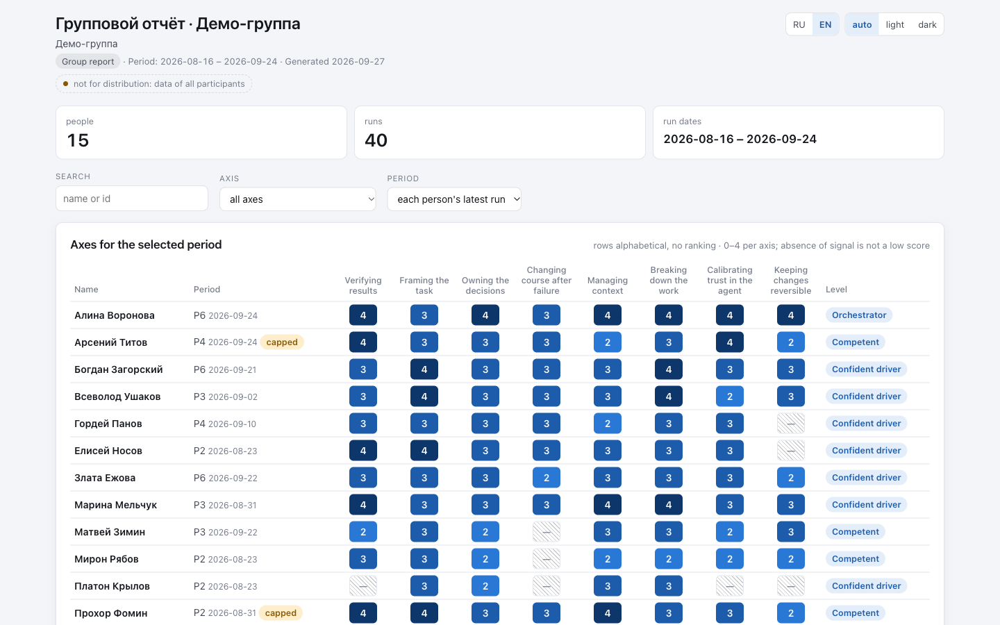
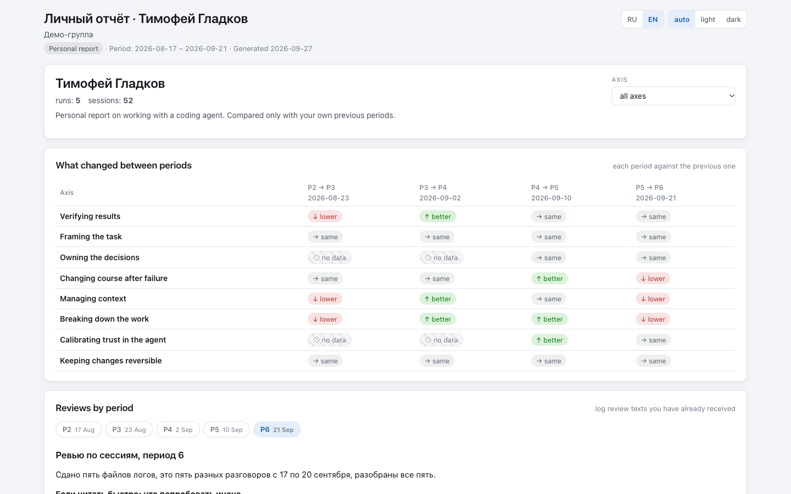

<p align="center"><a href="README.md">English</a> | <a href="README.ru.md">Русский</a></p>

# sessionretro

**A retro on how you work with a coding agent. It assesses the process, not the code.**

sessionretro is a Claude Code plugin that reads your agent session logs for a period and tells you how you lead the agent: how you frame tasks, verify results and keep decisions in your hands. Eight behaviour axes, each judgement backed by a quote from the log, one to three concrete next steps, and progress against your own previous period.

[](LICENSE)
[](CHANGELOG.md)
[](#quick-start)
[](#quick-start)

<p align="center"></p>

## Quick start

You need Claude Code and python3 3.10 or newer (standard library only, nothing to `pip install`). SpecStory is optional: it is only needed to collect logs of other agents (Cursor, Codex and others).

In Claude Code:

```text
/plugin marketplace add Serg1kk/sessionretro
/plugin install sessionretro@sessionretro
/sessionretro:setup
```

- The repository is private for now: you need access to it and either an SSH key on GitHub or `gh auth setup-git` so that Claude Code can clone it.
- After installing, run `/reload-plugins` or start a new Claude Code session, then call `/sessionretro:setup`.
- Developing the plugin: `claude --plugin-dir <path to plugin>` runs it from a local folder without installing.

`setup` asks up to 11 questions one at a time and creates the workspace `.sessionretro/` in your project. Then: collect logs, run a review, open the reports (sections below).

## What it does

- **Collects and sanitizes session logs**: Claude Code sessions directly, other agents through SpecStory exports, plain folders and git repositories. Secrets, e-mails, home-directory logins and the names you list are removed before anything is copied; your original logs are never modified.
- **Assesses eight behaviour axes**: verifying results, framing the task, owning the decisions, changing course after failure, managing context, breaking down the work, calibrating trust in the agent, keeping changes reversible. A score only stands under a verbatim quote; no signal means "insufficient data", not a low score.
- **Writes a personal text** with one to three next steps: the place in the log, what it cost and a concrete action. Next period it checks whether each step shows up in the new logs.
- **Shows progress over time**, always against your own previous period. People are never compared with each other.
- **Builds self-contained HTML reports**: for the reviewer, for the whole group and a personal file to send to a person; they open in any browser without a network.
- **Adapts to the person and the project**: the person card changes the wording, not the score; the text template, the models and effort of the agents are yours to change.

## How it works

```text
session logs ─▶ sanitizer ─▶ collectors ─▶ judge ─▶ run tracker ─▶ HTML reports
                             (batches,      (scores     (history,
                              quotes,        under       levels,
                              no scores)     quotes,     next steps)
                                             text)
```

Scripts collect the logs and sanitize them. Collector agents read a period's sessions in batches in parallel and write down verbatim quotes, without scores; nothing is cut, a batch is a split, not a sample. One judge agent combines the facts, scores each axis only under a quote and writes the text for the person. Scripts check the result, record the run, compute the level by formula and render the text with a replaceable template. Details: [docs/en/how-it-works.md](docs/en/how-it-works.md).

## Three modes

| Mode | Who reviews | People | Text to the person |
|---|---|---|---|
| `self` | you review yourself | one card, `me` | ready at once; scores hidden unless you turn on `show_scores` |
| `team` | a team lead or reviewer reviews the team | a card per person | goes out only after the reviewer approves it |
| `course` | an instructor reviews a learning group | a card per participant | goes out only after the instructor approves it |

One codebase for all three; the mode is chosen in `setup` and can be changed later.

## Setup

Open Claude Code in your project and run `/sessionretro:setup`: up to 11 questions one at a time (mode, people, log sources, the SessionEnd hook, models and effort for the agents, scores, periods, text template, log retention, `.gitignore`), then a single `sr.py setup-apply` call applies the answers and `doctor` shows the result. For scripts and CI: `setup-apply --answers <file|->` with a JSON object.
Project agents in `.claude/agents/sessionretro-*.md` are yours to edit and plugin updates leave them alone; proposals to the plugin authors are saved in `.sessionretro/improvements/` and leave your machine only when you file the issue yourself.
Details: [docs/en/customize.md](docs/en/customize.md); in Russian: [docs/ru/setup.md](docs/ru/setup.md), [docs/ru/customize.md](docs/ru/customize.md), [docs/ru/feedback.md](docs/ru/feedback.md).

## Collecting session logs

`/sessionretro:collect` (or `python3 "${CLAUDE_PLUGIN_ROOT}/scripts/sr.py" collect`) gathers Claude Code JSONL sessions, SpecStory exports, plain folders and, for team and course modes, git repositories into sanitized copies under `.sessionretro/logs/`, and keeps a session inventory with statuses in `.sessionretro/logs-index.json`.
With the SessionEnd hook enabled (`hook.enabled`), collection runs in the background after every Claude Code session. Claude Code deletes its own session logs after `cleanupPeriodDays` (30 days by default); `setup` offers to raise it to 90, and collected copies stay in the workspace.
Collection is not supported on Windows in 0.1. Details (in Russian): [docs/ru/collect.md](docs/ru/collect.md).

## Running a review

Ask Claude Code to "run the retro" or call the skill: `/sessionretro:review <person>` or `/sessionretro:review --all`; add `--no-ask` for unattended runs (`claude -p`) and `--approve <person>` to approve a draft. Collectors read the period's sessions in batches, the judge scores under quotes, scripts record the run and render the review to `.sessionretro/reviews/<person>/<run_id>.md`. In team and course modes the text stays a draft until the reviewer approves it.
The assessment in plain words: [docs/en/how-it-works.md](docs/en/how-it-works.md). In Russian: walkthrough, arguments and exit codes in [docs/ru/review.md](docs/ru/review.md), the same overview in [docs/ru/how-it-works.md](docs/ru/how-it-works.md), the axes and levels in [docs/ru/axes.md](docs/ru/axes.md).

## Reports

`/sessionretro:report` (or `python3 "${CLAUDE_PLUGIN_ROOT}/scripts/sr.py" report`) builds self-contained HTML files:

- `reports/reviewer.html`: everything for the reviewer: drafts, dossiers, evidence, recommendations, a "how the recipient sees it" view;
- `reports/group.html` (team and course modes): an overview to show the whole group: axes per person in alphabetical order, no texts, quotes or ranking;
- `reports/personal/<id>.html`: the file you send to a person: their periods, changes per axis, recommendations and approved review texts only;
- `~/.sessionretro/reports/index.html`: all your workspaces on one page.

A personal file is not written if it mentions other people from the workspace. `--anon` builds a copy with codes and made-up names for demos. Details (in Russian): [docs/ru/reports.md](docs/ru/reports.md).

<details>
<summary>Personal file: what a person receives</summary>

<p align="center"></p>

</details>

## Demo

The plugin ships an anonymized demo workspace: a real learning group with fictional names, 15 people, five periods, approved review texts in Russian. From the plugin folder:

```bash
python3 scripts/sr.py --workspace demo/workspace report --group --all-personal --reviewer --out-dir /tmp/sessionretro-demo
```

Then open `group.html`, `reviewer.html` and `personal/*.html` in `/tmp/sessionretro-demo`. What is inside and how it was anonymized: [demo/README.md](demo/README.md).

## Privacy

- **Everything runs locally.** The scripts are python on your machine; state lives in `.sessionretro/` of your project and in `~/.sessionretro/`. The plugin has no server, no account and no telemetry.
- **Model calls go through your Claude Code.** The collector, judge and critic are Claude Code agents in your session, under your account and its terms; they read the sanitized copies, not your original logs. The plugin adds no other destination for your data.
- **Network by scripts**: only `git clone`/`git pull` of repositories you listed as log sources, and `specstory sync` if SpecStory is one of the sources.
- **Sanitizer first.** Secrets, keys, e-mails, phones, home-directory logins, internal hosts and the names from person cards and `sanitize.names` are replaced before a log is copied.
- **Nothing is sent by the plugin.** Reports are files you share yourself; proposals to the authors are files you file as an issue yourself.
- **Limits.** The sanitizer is rule-based: a name of someone mentioned inside a log is removed only if it is in a person card or in `sanitize.names`; a client name in free text is visible only to you. Look through a copy in `.sessionretro/logs/` before you hand logs to anyone.

Details: [docs/en/privacy.md](docs/en/privacy.md).

## Quality and cost

We check the judge against a golden set: 15 real sessions with reference scores from earlier approved reviews, two full runs with an opus judge and sonnet collectors.

- 96–100 % of axis scores are within ±1 of the reference;
- the two runs differ by at most 1 point on any axis;
- the overall level matched the reference in 9 of 15 sessions.

An honest caveat: ±1 is a weak bar when most scores sit between 2 and 4, and the judge tends to pull scores towards the middle. Read the quotes and the text, not the numbers; that is also why people do not see scores by default.

Cost with the default models (opus judge, sonnet collectors): about $2 and 5–15 minutes per session; a live run of 4 sessions took about $3.30 and 13 minutes. It is paid through your own Claude Code. The English text of the judge has not been checked on a golden set yet: the axis references are in Russian.

## Configuration

The workspace settings are in `.sessionretro/config.json`; `setup` writes them, you can edit them by hand. `setup` does not ask about `reviewer_gate`, `sanitize` and `batches`: change them only in the file by hand (a `setup-apply` answer with these keys is rejected with code 2).

| Key | Default | What it changes |
|---|---|---|
| `mode` | set in `setup` | `self`, `team` or `course` |
| `lang` | language of the conversation | `ru` or `en`: texts and reports |
| `sources` | SpecStory + Claude Code of this project | where logs come from: `claude-jsonl`, `specstory`, `dir`, `git` |
| `hook.enabled` | `true` | background collection at the end of every Claude Code session |
| `models` | collector `sonnet`/`medium`, judge `opus`/`high`, critic `sonnet`/`medium` | model and effort of each agent |
| `period.mode` | `run` | periods by run date (`run`) or by date windows (`dates`); `labels` is accepted, but in 0.1 `review` does not ask for a label and such runs stay unlabeled |
| `show_scores` | `false` | show axis scores in personal reports (self mode) |
| `reviewer_gate` | `true` | in team and course modes a text is a draft until approved; by hand only |
| `sanitize.names`, `sanitize.extra_patterns` | empty | your own words and patterns to remove from logs |
| `batches.min_turns` | `4` | shorter sessions are marked "too short" and not assessed |
| `template` | `default` | the text template; your own copy lives in `.sessionretro/templates/` |

How to write to each person: the card `.sessionretro/people/<id>.yaml` and the shared `_default.yaml` ([docs/en/customize.md](docs/en/customize.md)).

## How it differs

- Claude Code's `/insights` shows where a session with Claude got stuck. sessionretro looks at your way of working across a period: eight axes, antipatterns and change against your own previous period.
- Usage trackers count tokens and money; session archivers such as SpecStory keep the history. sessionretro assesses the process itself and reads SpecStory exports as one of its sources.
- Rule-based coaching counts patterns. Here every judgement stands on a verbatim quote with the session and turn, and a missing signal is "insufficient data".
- Single-session reviewers look at the last chat. sessionretro reviews many sessions of a period and follows up on its own recommendations next period.
- Roles for a team lead and an instructor, with a reviewer gate before a text reaches a person. No rankings and no leaderboards.

## Documentation

- In English: [how the assessment works](docs/en/how-it-works.md), [privacy](docs/en/privacy.md), [customizing cards, templates and agents](docs/en/customize.md).
- In Russian: all pages, from setup to reports and FAQ.
- The full index: [docs/README.md](docs/README.md).

## Roadmap

0.1 is done and checked on Claude Code; logs of Cursor, Codex, Antigravity and other agents are collected through SpecStory, the assessment runs from Claude Code. Next: running the assessment from Codex and Cursor, readers for their session files, Windows support, English axis references. Never: rankings of people, token analytics, code review. Details (in Russian): [ROADMAP.md](ROADMAP.md).

## Contributing

Start with an issue: templates for a bug, a proposal and a privacy leak. Questions and ideas go to GitHub Discussions; there is no e-mail. Never attach session logs, names or keys. How to send a pull request, tests and style: [CONTRIBUTING.md](CONTRIBUTING.md); roles and decisions: [MAINTAINERS.md](MAINTAINERS.md).

## License

MIT, see [LICENSE](LICENSE).
