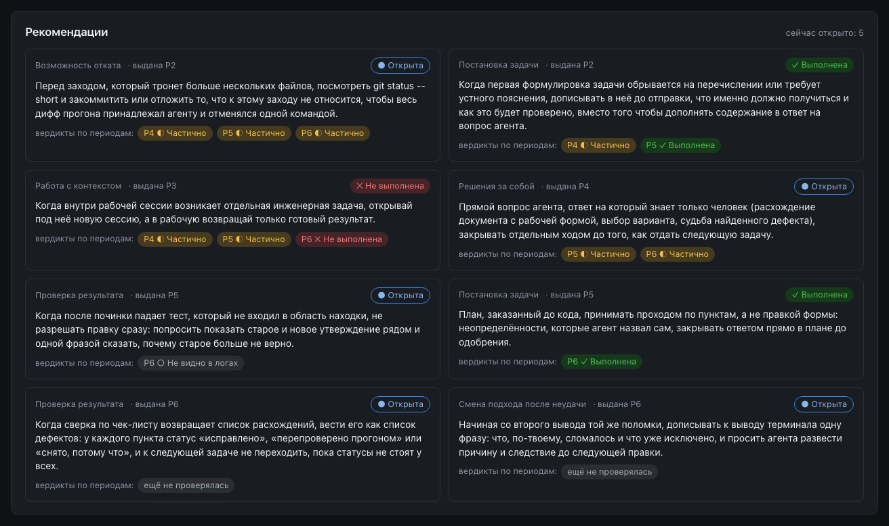

<p align="center"><a href="README.md">English</a> | <a href="README.ru.md">Русский</a></p>

# RetroPair

<p align="center"><strong><a href="https://retropair.dev/ru?utm_source=github&amp;utm_medium=referral&amp;utm_campaign=plugin_readme&amp;utm_content=readme_ru">Сайт и демо ↗ retropair.dev</a></strong></p>

**Review the pair. Improve the human.**

**Ретроспектива того, как вы работаете с AI-агентами. Оценивается работа человека, а не код.**

Практическая обратная связь для разработчиков на основе реальных сессий с кодинг-агентами: как ставить задачи, проверять результат и сохранять контроль над решениями.

RetroPair — плагин Claude Code, который читает логи ваших сессий с агентом за период и показывает, как вы ведёте агента: ставите задачу, проверяете результат, держите решения за собой. Восемь осей поведения, каждое суждение подкреплено дословной цитатой из лога, один-три конкретных следующих шага, проверка этих шагов в следующем периоде и динамика против вашего же прошлого периода. Людей между собой не сравнивает никогда.

[Сайт продукта](https://retropair.dev/ru?utm_source=github&utm_medium=referral&utm_campaign=plugin_readme&utm_content=readme_ru) · [Репозиторий плагина](https://github.com/Serg1kk/retropair) · Версия **0.2.0**

[](LICENSE)
[](CHANGELOG.md)
[](#быстрый-старт)
[](#быстрый-старт)

<p align="center"></p>

<sub>Все скриншоты сняты на обезличенном демо-workspace, который лежит в плагине (имена вымышленные; тексты ревью в демо — на русском, интерфейс переключается между русским и английским).</sub>

**Содержание:** [Для кого](#для-кого) · [Быстрый старт](#быстрый-старт) · [Как работает](#как-работает) · [Полный цикл](#полный-цикл) · [Восемь осей](#восемь-осей) · [Как ставится оценка](#как-ставится-оценка) · [Рекомендации и петля](#рекомендации-и-петля) · [Персонализация](#персонализация) · [Отчёты](#отчёты) · [Сбор логов](#сбор-логов) · [Приватность](#приватность) · [Настройка](#настройка) · [Стоимость, время и качество](#стоимость-время-и-качество) · [Демо](#демо) · [Частые вопросы](#частые-вопросы) · [Чем отличается](#чем-отличается) · [Документация](#документация) · [Планы](#планы) · [Как помочь](#как-помочь)

## Для кого

| Режим | Кто кого разбирает | Люди | Текст человеку |
|---|---|---|---|
| `self` | вы себя | одна карточка `me` | готов сразу: ревьюер — вы |
| `team` | тимлид или ревьюер — команду | карточка на каждого | черновик, пока его не одобрит ревьюер |
| `course` | преподаватель — учебную группу | карточка на каждого участника | черновик, пока его не одобрит преподаватель |

Один код на все три режима; режим выбирается в `setup` и меняется повторным запуском.

Что вы получаете:

- **Очищенные логи в одном месте**: сессии Claude Code напрямую, другие агенты (Cursor, Codex, Antigravity и другие) — через выгрузки SpecStory, папки с логами и, в режимах team и course, git-репозитории. Секреты, почта, логины в домашних путях и имена из вашего списка вычищаются до копирования; исходные логи не меняются никогда.
- **Оценку по восьми осям** того, как вы ведёте агента; каждый балл стоит на дословной цитате с номером сессии и хода. Нет сигнала — «мало данных», а не низкий балл.
- **Личный текст** с одним-тремя следующими шагами: где в логе, чем обошлось, что попробовать иначе. В следующем периоде оценщик сверяет каждый шаг с новыми логами.
- **Формулировку под человека**: обращение, объём, тон, что не объяснять, жёсткие запреты. Карточка меняет формулировку, но никогда не балл.
- **Самодостаточные HTML-отчёты**: для ревьюера (всё, включая «кухню»), для группы (без рейтинга) и личный файл, который можно отправить человеку. Открываются в любом браузере без сети.

## Быстрый старт

Нужны Claude Code и python3 версии 3.10 или новее (только стандартная библиотека, ставить через `pip` ничего не нужно). SpecStory — по желанию: она нужна только для логов других агентов.

В Claude Code:

```text
/plugin marketplace add Serg1kk/retropair
/plugin install retropair@retropair
/retropair:setup
```

- После установки выполните `/reload-plugins` или откройте новую сессию Claude Code, затем вызовите `/retropair:setup`.
- Для разработки плагина: `claude --plugin-dir <путь к plugin>` запускает его из локальной папки без установки.

`setup` задаёт до 11 вопросов по одному и создаёт в проекте workspace `.retropair/`. Дальше попросите Claude Code «собери мои логи» и «проведи ретро» и откройте отчёты: [полный цикл](#полный-цикл) ниже проходит каждый шаг.

Уже используете SessionRetro? Перед настройкой прочитайте [инструкцию перехода](docs/ru/migration.md): новое состояние хранится в `.retropair/`, перенос сначала показывает план и останавливается при конфликте двух каталогов. Основной CLI — `scripts/rp.py`; `scripts/sr.py` остаётся совместимым входом для существующих скриптов.

## Как работает

<p align="center"></p>

Карточка человека идёт только к оценщику: она меняет формулировку, а не балл. Шаги одного периода оценщик сверяет в следующем, а в режимах team и course текст уходит человеку только после одобрения ревьюера. После одобренного прогона плагин может предложить правки карточки; карточка меняется, только когда ревьюер выполнит `people apply`.

<details>
<summary>Текстовая версия</summary>

```text
логи сессий ─▶ санитайзер ─▶ сборщики ─▶ оценщик ─▶ трекер ─▶ HTML-отчёты
                             (пачки,      (оценки    (история,
                              цитаты,      под        уровни,
                              без баллов)  цитатами,  шаги)
                                           текст)
                                            ▲
карточка человека: profile + feedback ──────┘  меняет формулировку, не балл

следующий период: оценщик сверяет каждый шаг ─▶ выполнена · частично · не видно · не выполнена
отчёт ревьюера ─▶ ревьюер одобряет (team, course) ─▶ личный отчёт ─▶ человек
трекер ─▶ предложение правки карточки ─▶ ревьюер подтверждает (people apply / reject) ─▶ карточка человека
          (поля карточки по логам; баллы не меняются)
```

</details>

Скрипты собирают логи и очищают их. Агенты-сборщики читают сессии периода пачками параллельно и выписывают дословные цитаты, баллов не ставят; ничего не срезается — пачка это разбиение, а не выборка. Один агент-оценщик сводит факты, ставит оценку по каждой оси только под цитату и пишет части текста. Скрипты проверяют результат, записывают прогон, считают уровень по формуле и собирают текст по заменяемому шаблону. Подробно: [docs/ru/how-it-works.md](docs/ru/how-it-works.md).

## Полный цикл

Каждый шаг — скилл, который можно вызвать по имени или просто попросить своими словами; те же шаги — обычные команды `rp.py` для скриптов и CI (`python3 "${CLAUDE_PLUGIN_ROOT}/scripts/rp.py" <команда>`).

| Шаг | Команда | Что происходит | Что появляется |
|---|---|---|---|
| 1. Настройка | `/retropair:setup` | до 11 вопросов (режим, люди, источники логов, SpecStory, хук, модели, баллы, периоды, шаблон, срок хранения логов, `.gitignore`), затем `setup-apply` применяет ответы, а `doctor` показывает итог | `.retropair/config.json`, `people/_default.yaml`, `people/<id>.yaml`, проектные агенты `.claude/agents/retropair-*.md` и `agents.json`, запись в `~/.retropair/workspaces.json` |
| 2. Сбор | `/retropair:collect` или сам, хуком SessionEnd | источники читаются, каждый лог проходит санитайзер, копии ложатся в workspace, в перечне сессий — статусы (новые, выросшие, без изменений, дубли, пропавшие, исключённые) | `logs/<id>/…`, `logs-index.json`, `collect.log` (хук) |
| 3. Ревью | `/retropair:review <person>` или `--all` | проектные агенты синхронизируются; сессии периода режутся на пачки; сборщики работают параллельно; `check-collector` сверяет каждую цитату с логом; оценщик ставит оценки и пишет; `append` записывает прогон; `level` считает уровень; `render-review` собирает текст; `verify` проверяет, что всё закрыто | `runs/pending/<person>/batch-NN.json` и `judge.json`, история `runs/process-reviews.json`, текст `reviews/<person>/<run_id>.md` |
| 4. Одобрение | `/retropair:review --approve <person>` или `rp.py approve <person>` | team и course: ревьюер читает черновик и одобряет; с этого момента его шаги считаются полученными. Затем скилл выполняет `people suggestions <person> --refresh`; голая `rp.py approve` меняет только статус, после неё запустите эту команду сами | `status: approved` в файле ревью, `approved_at` в прогоне; предложения к карточке `people/<id>.suggestions.json` (после `--refresh`) |
| 5. Отчёты | `/retropair:report` | HTML-отчёты пересобираются по истории; личный файл не пишется, если в нём упомянуты другие люди | `reports/reviewer.html`, `reports/group.html`, `reports/personal/<id>.html`, `~/.retropair/reports/index.html` |
| 6. Следующий период | снова сбор и ревью | оцениваются только новые сессии и новые хвосты выросших; по каждому открытому шагу прошлых периодов оценщик выносит вердикт | новый прогон; вердикты в истории рекомендаций каждого отчёта |

<details>
<summary>Что скилл ревью делает внутри, по шагам</summary>

1. Находит людей с новыми или выросшими сессиями; нет новых логов — нет ревью этого человека и нет выводов о нём.
2. Выполняет `agents sync`: непроправленные проектные агенты обновляются до промптов текущей версии плагина, правленые не трогаются, о них приходит напоминание.
3. Режет период на пачки по времени начала (`batches`): каждая пригодная сессия попадает ровно в одну пачку; сессии, где ваших сообщений меньше `batches.min_turns` (4), отмечаются «слишком короткими» и не подаются снова, пока не вырастут.
4. Запускает по сборщику на пачку, параллельно. Сборщики никогда не видят карточку человека и прошлые баллы.
5. `check-collector` проверяет каждый выход: баллов нет, все восемь осей на месте, каждая цитата найдена в названном ходе как ваше сообщение или вызов инструмента, а не слова агента. Сдвинутый номер хода чинится сам с предупреждением; после двух перезапусков несверенные цитаты отбрасываются, а ось получает «мало данных» с причиной «цитаты не сошлись с логом».
6. Оценщик сводит все пачки, ставит оценки под цитаты, выносит вердикты по открытым рекомендациям и пишет части текста.
7. `append` проверяет и записывает прогон (оценка без цитаты, уровень выше потолка гейта, запретное слово в тексте — код `1` и перезапуск оценщика); `mark-logs` закрывает пометки сессий; `level` считает уровень; `render-review` собирает текст.
8. В team и course без `--no-ask` текст можно прогнать через агента-критика; его замечания видит ревьюер.
9. `verify` должен быть зелёным: у каждого прогона есть пометки, текст и уровень.
10. Сводка по человеку: сколько сессий оценено и исключено, статус и путь текста, предупреждения, ожидающие предложения к карточке с готовыми командами `people apply` / `people reject`. Сам скилл их не применяет.

`--no-ask` — запуск без единого вопроса (для `claude -p`), `--task-summary "…"` — одна нейтральная строка о работе. Запуск, аргументы и коды выхода: [docs/ru/review.md](docs/ru/review.md); оценка простым языком: [docs/ru/how-it-works.md](docs/ru/how-it-works.md).

</details>

## Восемь осей

| Ось | Что наблюдаем | Сильнее | Слабее | Не штрафуется никогда |
|---|---|---|---|---|
| **Проверка результата** (в уровне считается дважды) | входит ли проверка в задачу и принимается ли результат по доказательству | критерий готовности назван до работы; проверка запущена и её вывод прочитан; просмотрен весь дифф | «все тесты прошли» принято без вывода; сразу следующая задача после «готово» | нет тестов в проекте, где тестов нет вовсе; проверка в другом терминале, которую лог не показывает |
| **Постановка задачи** | что попало в промпт до начала работы агента и когда | факт, которого агент не узнает из репозитория, ссылки на файлы, одна задача, адресные ограничения, план до многофайловой работы | пять задач в одном сообщении; ограничения, собранные после «убери, я не просил» | откуда взят промпт (скопирован, найден, сгенерирован); ограничения, вынесенные в файл правил проекта |
| **Решения за собой** | остаётся ли человек автором решений, когда агент пишет код | вопросы про механику, отказ с причиной, возражение против архитектурного хода, реакция на предупреждение | схема данных принята молча; «на твоё усмотрение» в продуктовом вопросе | как часто человек вмешивается: короткое «да» после заданной заранее рамки — это владение |
| **Смена подхода после неудачи** | что происходит, когда результат не подходит | каждая попытка приносит новый факт; после второй неудачи меняется рычаг; неудачная правка откатывается | третье «исправь» без нового факта; заплатка на заплатку | число итераций; раздражение, капслок, восклицательные знаки |
| **Работа с контекстом** | чем заполнено окно, что уходит в файлы, что делается, когда окно распухает | агент опирается на правила проекта; файлы подаются адресно; итог сохранён до сброса; после сжатия задача поставлена заново | темы смешаны в одной сессии; незамеченное автосжатие | качество самого файла правил; числовые правила, когда инструмент не сообщает заполнение окна |
| **Разбиение работы** | как нарезана работа и куда уходит каждый кусок | одна задача за заход; проверка и коммит между задачами; независимые куски в своих контекстах | всё одним промптом или диктовка по нажатиям без критерия готовности | число кусков само по себе: нарезка ради нарезки ничего не даёт |
| **Мера доверия агенту** | меняется ли доверие с ценой ошибки | к миграции или боевым данным отношение иное, чем к переименованию; заранее готовы ветка или тестовая база; причина не проверять сказана вслух | одинаковое доверие к переименованию и удалению | непроверенная дешёвая обратимая правка, если причина сказана («одноразовое, не смотрю») |
| **Возможность отката** | насколько дёшево отменить неудачный ход агента | точка возврата до запуска; шаг размером с одну единицу работы; рискованное — в ветке; плохой результат выброшен целиком | нет точки возврата, и неудача чинится поверх; старт на грязном дереве | число коммитов; ветки в маленьком проекте одного человека; версионирование, не видное в логе («мало данных», а не ноль) |

Не оценивается вовсе: качество кода, архитектура, полнота решения, гладкость формулировок, длина сообщений, скорость, голосовой ввод. Оси, гейт и 42 антипаттерна подробно: [docs/ru/axes.md](docs/ru/axes.md).

## Как ставится оценка

| Правило | Что это значит на деле |
|---|---|
| **Пачки, а не выборка** | период с большим числом сессий режется на пачки по времени, и прочитана каждая пригодная сессия; сессия никогда не делится между пачками; размер пачки считается по вашим сообщениям, поэтому длинные трассы инструментов места не занимают |
| **Две ступени, всегда** | сборщики выписывают цитаты без баллов; один оценщик сводит все пачки и ставит оценки. Путь у всех одинаковый, поэтому рост виден как рост, а не как разница в подсчёте |
| **Балл только под цитату** | ось получает 0–4 только с дословной цитатой и её адресом (сессия и ход); оценку без цитаты скрипт отклоняет. Частота считается по всем пачкам, поэтому единичный эпизод не топит ровную картину |
| **«Мало данных» — не провал** | если поведения в логе не видно, ось получает «мало данных» с одной из девяти причин (лог слишком короткий, работа шла вне лога, инструмент не пишет трейс, цитаты не сошлись с логом…). В низкий балл это не превращается никогда; для низкого балла нужно положительное доказательство |
| **Уровень — по формуле** | скрипт берёт медиану оценённых осей, проверка результата — дважды: от 3,5 Оркестратор, от 2,75 Уверенный водитель, от 2,0 Компетентный, от 1,0 Наивный, ниже — Пассажир; оценено меньше трёх осей — «мало данных». Уровень оценщика — только сверка |
| **Гейт — потолок, а не ноль** | шесть триггеров, видных в логе (слепое принятие крупного изменения, продуктовый выбор отдан агенту, предупреждение проигнорировано, «готово» принято без проверки, заявленное непонимание не разобрано, нет позиции за длинную сессию): один ограничивает уровень «Компетентным», два и больше — «Развивается». Тишина гейт не включает никогда |
| **Чего оценщик не получает никогда** | прошлых баллов и уровней, впечатлений ревьюера, критериев приёмки задачи, самого кода, файлов правил проекта, логов других людей |
| **Критик** | в team и course без `--no-ask` отдельный агент читает черновик текста, его замечания уходят ревьюеру |
| **Правка ревьюера** | у прогона в истории может быть `operator_override` (оси с новыми баллами, `why`, `by`, `at`): уровень считается с ней, отчёты помечают балл «правка ревьюера», при переоценке через `append --replace` она сохраняется. Отдельной команды для неё в 0.2.0 нет; ошибочный прогон целиком отзывается `rp.py retract <run_id> --why "…"` |

## Рекомендации и петля

В каждом тексте один-три пункта «попробовать иначе». Пункт собирается из полей оценщика: дата и место в логе, дословная цитата, чем это обошлось, конкретное действие на следующую сессию и, в подробном тексте, до двух соседних приёмов. Каждое действие — рекомендация со своим id (`REC-<person>-NNN`) в истории прогонов.

В следующем периоде оценщик ищет каждую открытую рекомендацию в новых логах и выносит один из пяти вердиктов:

| Вердикт | Закрывает рекомендацию? |
|---|---|
| Выполнена | да, статус «Выполнена» |
| Не выполнена | да, статус «Не выполнена» |
| Частично | нет, остаётся открытой |
| Не видно в логах | нет, остаётся открытой: «не видно» не значит «проигнорировал» |
| Рано судить | нет: все логи периода закончились раньше, чем человек получил рекомендацию |

Рекомендация судится только по логам, записанным после того, как человек её получил: в режиме self — время прогона, в team и course — время одобрения. Пока текст черновик, о его рекомендациях не спрашивают. Каждый отчёт с рекомендациями (ревьюера, личный, групповой с карточками людей) показывает историю под рекомендацией, от старого периода к новому (например, «P4 ◐ Частично · P5 ◐ Частично · P6 ◐ Частично»), пояснение оценщика — в подсказке; непроверенная рекомендация так и подписана.

<p align="center"></p>

`rp.py open-recs <person>` — открытые рекомендации; `rp.py compare <run_a> <run_b>` — сравнение двух прогонов одного человека.

## Персонализация

У каждого человека есть карточка `.retropair/people/<id>.yaml` (в режиме self — `me.yaml`); общие настройки текста лежат в `.retropair/people/_default.yaml`, а карточка переопределяет только те поля, которые в ней указаны. Карточка проверяется при каждом чтении: неизвестное значение (например, `tone: soft`) — код `1` с именем поля.

```yaml
id: "alex"
name: "Alex"
group: team-a
profile:
  role: backend developer
  grade: middle
  years: 4
  stack: Python, Postgres
  tools: Claude Code
  constraints: нет прав на прод
feedback:
  address: вы
  length: short
  tone: supportive
  skip_basics:
    - что такое git
  boundaries:
    - не предлагать облачные сервисы
consent:
  logs: true
  date: 2026-09-01
```

**Карточка меняет формулировку, не балл.** Один и тот же лог у архитектора и у новичка получает один и тот же балл; «он же senior, с него спрос выше» и «новичок, ему простительно» — обе поправки запрещены. Сборщики карточку не видят вовсе, а текст её не пересказывает («как senior с девятью годами опыта» не пишется). Что именно получает оценщик: `rp.py people context <id>`.

<details open>
<summary><b>profile</b>: кто этот человек (все поля необязательные, по умолчанию пусто)</summary>

| Поле | Пример | Как меняет текст |
|---|---|---|
| `role` | `backend developer` | вместе с `grade` и `years` задаёт регистр формулировок |
| `grade` | `senior` | один и тот же совет звучит как шаг для новичка и как указание для того, кто сам учит этому других |
| `years` | `4` (целое число) | как `grade` |
| `stack` | `Java, Kotlin, Postgres` | примеры — из того, с чем человек работает |
| `tools` | `Claude Code, Cursor` | объясняет отсутствие следов (инструмент без трейса терминала → «мало данных» с причиной, а не низкий балл) и отсекает невыполнимые советы («новая сессия» в Cursor вместо команды, которой в нём нет) |
| `constraints` | `закрытый контур, нет прав на прод` | как `tools`: советы, которые среда не позволяет, отпадают |

</details>

<details open>
<summary><b>feedback</b>: как писать человеку (по умолчанию — из <code>_default.yaml</code>)</summary>

| Поле | Значения | По умолчанию | Кто использует | Как меняет текст |
|---|---|---|---|---|
| `address` | `ты` · `вы` · `you` | `ты` | оценщик + проверка | одно обращение на весь текст (`you` — для текста на английском); для `ты` и `вы` `render-review` отклоняет текст, где обращение не совпадает; `you` скрипт не проверяет |
| `length` | `short` · `detailed` | `detailed` | оценщик + проверка | `short`: вступление одной фразой, не больше двух пунктов, без соседних приёмов, по оси одна фраза; `detailed`: до трёх пунктов, до двух приёмов в каждом, до двух предложений доказательств на ось. Скрипт проверяет число пунктов, приёмы в `short` и одну фразу на ось в `short` и отклоняет, а не обрезает; вступление одной фразой и предел доказательств в `detailed` — инструкция оценщику |
| `tone` | `direct` · `supportive` | `direct` | оценщик | `supportive` добавляет одну строку в конце, которая закрепляет устойчивый приём с датой и местом; `direct` без неё. Похвала запрещена в обоих |
| `opening_summary` | `true` · `false` | `false` | оценщик | `true`: после строки покрытия две-три фразы простым языком «что видно и что менять первым» |
| `mark_sections` | `true` · `false` | `false` | оценщик | `true`: во вступлении одна фраза-навигация «сначала что менять, ниже на чём это стоит» |
| `practices` | `true` · `false` | `true` | оценщик + проверка | `false`: соседних приёмов нет вовсе; текст с ними скрипт отклоняет |
| `skip_basics` | список | пусто | оценщик | то, что человек и так знает, не подаётся как открытие — только как место, где он разошёлся со своей же практикой |
| `boundaries` | список | пусто | оценщик | **запрет, а не пожелание**, на рекомендации и приёмы («не переносить советы на рабочий стек»); пункт, который его нарушает, заменяется следующим по цене |
| `avoid` | список | пусто | оценщик | такой же жёсткий запрет на сам текст: слова, темы, приёмы подачи |
| `value_focus` | `finding` · `full` | `finding` | оценщик | `finding`: пункты только про находки этого прогона; `full`: и про ровные места, где есть способ дешевле |
| `show_dynamics` | `true` · `false` | `true` | оценщик + отчёт | `true`: вердикт по прошлой рекомендации той же оси упоминается одной фразой; в виде отчёта «только динамика» переходы показываются только при `true` |
| `show_scores` | `true` · `false` | не задано (из `config.json`) | отчёт | вид личного отчёта: баллы и уровень или только динамика ↑ → ↓ ◇. Оценщику не подаётся |
| `channel` | `file` · `telegram` · `slack` · `email` | `file` | пока никто | хранится и проверяется; оценщику не подаётся, и в 0.2.0 рендер собирает одинаковый markdown для любого канала |
| `template` | `default` · `workspace` · имя файла | `default` | рендер | каким шаблоном раскладывается текст (ниже) |
| `prefix` | строка | `""` | рендер | строка перед текстом, например приветствие; пустая — строки нет |

</details>

**Шаблон текста.** Шаблон задаёт только раскладку: порядок частей, приветствие, подпись. В нём ровно пять подстановок в двойных фигурных скобках: `prefix`, `opening`, `actions`, `criteria`, `closing`. Копию для правки даёт ответ «Своя копия шаблона» в `setup` (ложится в `.retropair/templates/feedback.md`), подключается строкой `template: workspace`; можно держать несколько шаблонов рядом и выбирать их в карточке, `template: short.md`. Нет файла шаблона — сборка текста останавливается с кодом `1` и путём, который она искала; тихой подмены нет. Подробно: [docs/ru/customize.md](docs/ru/customize.md).

### Один вывод оценщика — две карточки

Что на самом деле происходит при смене карточки, на демо-workspace: один и тот же записанный вывод оценщика по одному участнику демо (прогон `P6`) собран дважды командой `render-review` во временной копии демо — сначала с его собственной карточкой, потом с другой.

<table>
<tr><th>Карточка A (карточка из демо)</th><th>Карточка B</th></tr>
<tr><td>

```yaml
feedback:
  address: ты
  length: detailed
  tone: supportive
  opening_summary: true
  prefix: "Привет!"
```

</td><td>

```yaml
feedback:
  address: вы
  length: short
  tone: direct
  opening_summary: false
  prefix: "Добрый день!"
```

</td></tr>
<tr><td>

Текст записан, код `0` (фрагмент, строки перенесены):

```text
Привет!

Разобрано сессий: 5, ходов: 788.

**Если читать быстро: что попробовать иначе.**

**Первое.** Стоит попробовать: Когда сверка
по чек-листу возвращает список расхождений,
вести его как список дефектов: …

**Второе.** Стоит попробовать: Начиная со
второго вывода той же поломки, дописывать к
выводу терминала одну фразу: что, по-твоему,
сломалось и что уже исключено, …
```

</td><td>

Ничего не записано, код `1` (строки перенесены):

```text
retropair: текст ревью
demo-course_p02_P6_20260921T201000Z не записан,
нарушены запреты (1):
  обращение 'твоему' при address: вы
```

</td></tr>
</table>

Что это показывает честно: скрипт ничего не переформулирует. Он ставит `prefix`, раскладывает части по `template` и держит карточку: текст, написанный на «ты», не уйдёт по карточке на «вы», текст из трёх пунктов не уйдёт по карточке `short`. Формулировки под карточку B пишет оценщик в следующем прогоне — ему подаётся срез карточки B (его печатает `rp.py people context p02`).

### Предложения правок карточки

После одобренного прогона RetroPair сверяет карточку с тем, что видно в логах, и предлагает правки. Сам он карточку не меняет: правка попадает в файл только через `people apply`. Предложения пересчитывает `people suggestions --refresh`; скилл `review` запускает её в конце прогона и после `--approve`. Голая `rp.py approve` меняет только статус, после неё запустите `rp.py people suggestions <person> --refresh` сами.

| Откуда | Что предлагается |
|---|---|
| инструменты из логов | агенты и модели последнего одобренного прогона, которых нет в `profile.tools` (номера сборок отброшены, дубли схлопнуты) |
| устойчиво сильные оси | оси с баллом 3 и выше в двух последних одобренных периодах → добавить в `feedback.skip_basics`; ось, которая уже предлагалась (даже отклонённая), повторно не предлагается |
| оценщик | поле `profile`, с которым расходятся логи (стек, инструменты, ограничения среды), с основанием и цитатой; учитывается только последний одобренный период |

Не предлагается никогда: баллы, уровни, текст ревью, а из полей `feedback` — тон, длина и канал; их правят только руками.

```bash
python3 "${CLAUDE_PLUGIN_ROOT}/scripts/rp.py" people suggestions --refresh          # пересчитать по одобренным прогонам
python3 "${CLAUDE_PLUGIN_ROOT}/scripts/rp.py" people suggestions alex --all         # вместе с применёнными и отклонёнными
python3 "${CLAUDE_PLUGIN_ROOT}/scripts/rp.py" people apply alex S-alex-001
python3 "${CLAUDE_PLUGIN_ROOT}/scripts/rp.py" people reject alex S-alex-002 --reason "сам решу"
```

`apply` меняет одну строку (или добавляет пункты списка), комментарии и порядок остаются; если после этого карточка не прошла проверку, файл возвращается как был, код `1`. Предложение, поле которого успели поменять руками, `--refresh` закрывает статусом `stale`. Предложения хранятся рядом с карточкой, в `people/<id>.suggestions.json` (поле, старое и новое значение, основание, прогон, статус `pending` / `applied` / `rejected` / `stale`); ожидающие видны в `reviewer.html` с готовыми командами, их число показывает `doctor` (`card_suggestions_pending`). В личном файле и в `group.html` их нет никогда.

<p align="center"></p>

## Отчёты

`/retropair:report` (или `rp.py report`) собирает самодостаточные HTML-файлы. Всё, что показывает файл, лежит в нём самом, поэтому каждый файл собирается по белому списку того, что положено видеть его читателю: отрезанного в файле нет, а не спрятано в браузере.

| Файл | Для кого | Что внутри |
|---|---|---|
| `reports/reviewer.html` | ревьюер (в режиме self — вы) | всё: обзор, карточка каждого человека, оси во времени с пояснениями оценщика, доказательства-цитаты, антипаттерны, флаги, черновики и одобренные тексты, досье, рекомендации, предложения к карточке, переключатель «Как видит адресат» |
| `reports/group.html` | ревьюер, тимлид, преподаватель (team и course) | только одобренные прогоны: теплокарта «люди × оси» по алфавиту с фильтрами по имени, оси и периоду, распределение по каждой оси; по клику на строку — карточка человека: оси во времени, одобренные тексты по периодам (с вкладкой «все»), рекомендации с историей вердиктов. Сверху плашка «не для рассылки» |
| `reports/personal/<id>.html` | сам человек | его карточка, как у ревьюера, без всего, что только для ревьюера |
| `~/.retropair/reports/index.html` | вы | все ваши workspace со ссылками на их отчёты |

<details>
<summary>Галерея: карточка в группе, личный отчёт, тексты, рекомендации, страница workspace, тёмная тема</summary>

**Карточка в группе.** Клик по строке теплокарты: графики, «Фидбэк по периодам» на вкладке «все» и рекомендации с вердиктами.

<p align="center"></p>

**Личный отчёт в виде «только динамика»** (`--trend`): та же карточка без баллов и уровня, переход к каждому периоду: ↑ лучше, → ровно, ↓ ниже, ◇ нет данных.

<p align="center"></p>

**Тексты ревью по периодам.** Только одобренные ревьюером тексты, отправляемая часть; вкладка «все» показывает их подряд.

<p align="center"></p>

**Рекомендации и что с ними стало.** Статус и цепочка вердиктов у каждой рекомендации.

<p align="center"></p>

**Все workspace на одной странице.**

<p align="center"></p>

**Тёмная тема** (переключатель «авто», светлая и тёмная — в каждом отчёте).

<p align="center"> </p>

</details>

### Что видит только ревьюер и что видят оба

Один и тот же участник демо, последний период: слева карточка ревьюера, справа личный файл так, как его получит человек (у ревьюера тот же вид — кнопкой «Как видит адресат»).

<table>
<tr><th>Ревьюер: <code>reviewer.html</code></th><th>Человек: <code>personal/&lt;id&gt;.html</code></th></tr>
<tr><td></td>
<td></td></tr>
</table>

| Блок | Ревьюер | Личный файл | `group.html` | Почему |
|---|:---:|:---:|:---:|---|
| Оси во времени (графики) | ✅ | ✅ баллы или ↑ → ↓ ◇ в виде «только динамика» | ✅ | собственная динамика человека |
| Уровень по последнему прогону | ✅ | ✅ в виде с баллами, ❌ в «только динамика» | ✅ в теплокарте | то же правило, что для баллов |
| Агенты и модели | ✅ | ✅ | ❌ | контекст для человека |
| Одобренные тексты ревью (отправляемая часть) | ✅ | ✅ | ✅ | человек их уже получил |
| Рекомендации с историей вердиктов | ✅ (и из черновиков, с пометкой) | ✅ только одобренные прогоны | ✅ только одобренные прогоны | петля рекомендаций |
| Пояснения оценщика под графиками | ✅ | ❌ | ❌ | рабочие заметки оценки |
| «Главное по прогону» | ✅ | ❌ | ❌ | служебная строка для ревьюера |
| Доказательства: цитаты по осям с сессией и ходом | ✅ | ❌ | ❌ | сырые куски логов остаются у ревьюера |
| Досье: сессии, файлы, id, команды открыть кусок лога | ✅ | ❌ | ❌ | чтобы ответить на «а где это было?» |
| Антипаттерны, флаги безопасности, доказательства гейта | ✅ | ❌ | ❌ (только плашка «потолок») | ярлыки — ревьюеру, человеку — действия |
| Черновики и неодобренные прогоны | ✅ с пометкой «черновик» | ❌ | ❌ (и в теплокарте, и на графиках) | неодобренное видит только ревьюер |
| Служебная шапка файла ревью, пути к логам | ✅ | ❌ (пути машины в пояснениях вердиктов срезаны: путь внутри workspace — `logs/<id>/<файл>`, прочий — имя файла) | ❌ | пути машины и бухгалтерия |
| Пометка «правка ревьюера» | ✅ | ❌ (показан итоговый балл) | ✅ значок | человек видит результат, а не правку |
| Предложения к карточке | ✅ | ❌ | ❌ | карточка — инструмент ревьюера |
| Данные других людей | ✅ | ❌ никогда | ✅ (это и есть вид группы) | личный файл — про одного человека |

<details>
<summary>Баллы или только динамика: как выбирается вид личного отчёта</summary>

У личного отчёта два вида: **с баллами** (`scores`, по умолчанию: графики с баллами 0–4 и уровень, как в карточке ревьюера) и **только динамика** (`trend`: переходы ↑ → ↓ ◇ между периодами, без баллов и уровня — их нет и в данных файла). Решает первое заданное:

1. флаг запуска `--scores` или `--trend` (прежние имена `--show-scores` и `--hide-scores` работают); два флага вида сразу — код `2`;
2. `feedback.show_scores: true | false` в карточке человека (или в `_default.yaml` — для всех);
3. `show_scores` в `.retropair/config.json` (после `setup` — `true`).

При сборке личных отчётов скилл `/retropair:report` один раз спрашивает «Баллы или только динамика?» и передаёт ответ флагом; с `--no-ask` вид берётся из карточек и конфига. В самом тексте ревью баллов нет никогда.

</details>

<details>
<summary>Переключатели группового отчёта: <code>--no-details</code>, <code>--anon</code></summary>

- `--no-details` (вместе с `--group`) или `"report": {"group_details": false}` в `config.json`: групповой отчёт без карточки человека, только цифры и графики; так из `group.html` убираются тексты фидбэка и рекомендации.
- `--anon`, лучше вместе с `--out-dir <папка>` (без него обезличенные файлы лягут в `.retropair/reports/` рядом с обычными): обезличенная копия для демо, статьи или issue. Id заменяются кодами (`p01`…), имена — вымышленными, почта, ссылки на профили, хэндлы и домашние пути убираются; файл, в котором осталось настоящее имя или id, не пишется (код `1`).
- `group.html` без `--anon` не пишется, если в нём есть слово из `sanitize.names`: старый файл удаляется, код `1`.

</details>

**Как отправить личный файл.** Одобрите текст (черновик в личный файл не попадает никогда), соберите `rp.py report --personal alex`, откройте `reviewer.html` и нажмите «Как видит адресат», чтобы проверить, затем отправьте `reports/personal/alex.html` любым удобным способом. Это один самодостаточный файл без внешних скриптов и шрифтов; получателю ничего ставить не нужно. Перед записью команда проверяет файл на имена и id других людей workspace и на слова из `sanitize.names`: нашлось — этот файл не пишется, старый удаляется, код `1`. Сам плагин не отправляет ничего.

Полная страница: [docs/ru/reports.md](docs/ru/reports.md).

## Сбор логов

`/retropair:collect` (или `rp.py collect`) читает источники из `config.json` и карточек, пропускает каждый лог через санитайзер и пишет копии в `.retropair/logs/`. Повторять безопасно: исходники не меняются, неизменившиеся копии не перезаписываются.

| Тип источника | Что читает | Настройки |
|---|---|---|
| `claude-jsonl` | сессии Claude Code: `*.jsonl` в `~/.claude/projects/<папка проекта>/`, вместе с сессиями субагентов | `"project": "auto"` или путь к другому проекту |
| `specstory` | markdown-выгрузки SpecStory (Claude Code, Codex, Cursor, Antigravity); если стоит SpecStory 2.6.0+, `collect` сначала выполняет `specstory sync` | `"path"` от корня проекта |
| `dir` | любая папка с логами `.md`, `.markdown`, `.txt`, `.jsonl`, например ручной `/export` | `"path"` |
| `git` | репозиторий с логами другого человека: клонируется в `~/.retropair/clones/` и обновляется при следующем сборе (team и course) | `"url"`, по желанию `"branch"` |

Читателей `codex-jsonl` и `cursor-jsonl` в 0.2 нет: эти агенты собираются через SpecStory. Источники можно указать и в карточке (`sources:`); их логи считаются логами этого человека.

- **Перечень и статусы.** `logs-index.json` хранит каждую сессию со статусом: `new`, `grown` (оценена, потом появились новые ходы — в следующий раз оценивается только хвост), `unchanged`, `duplicate` (из двух копий одной сессии берётся JSONL, а не выгрузка SpecStory), `gone`, `excluded`. `rp.py inventory` пересчитывает его по копиям.
- **Хук SessionEnd.** С `hook.enabled` (включён после `setup`) сбор запускается в фоне в конце сессии Claude Code; вывод пишется в `.retropair/collect.log`. Хук работает только для workspace из вашего реестра `~/.retropair/workspaces.json`, поэтому чужой репозиторий с закоммиченным конфигом ваши логи не соберёт.
- **Согласие.** `consent.logs: false` в карточке останавливает сбор источников этого человека, а собранные раньше копии исключаются из пачек и оценки. Сколько карточек без согласия, показывает `doctor`.
- **Срок хранения.** Claude Code удаляет свои логи через `cleanupPeriodDays` (по умолчанию 30 дней); `setup` предложит поднять срок до 90, а собранные копии остаются в workspace.
- **Windows** в 0.2 для сбора не поддерживается.

Подробно: [docs/ru/collect.md](docs/ru/collect.md).

## Приватность

- **Всё работает локально.** Скрипты — python на вашей машине; состояние лежит в `.retropair/` проекта и в `~/.retropair/`. Ни сервера, ни аккаунта, ни телеметрии.
- **Что уходит в модель.** Сборщик, оценщик и критик — агенты Claude Code в вашей сессии, под вашим аккаунтом и его условиями. Сборщики читают очищенные копии; оценщик получает факты сборщиков, пути к копиям для точечной сверки цитат, открытые рекомендации и короткий срез карточки. Ни один агент не получает прошлых баллов, заметок ревьюера и логов других людей.
- **Сеть из скриптов** — только `git clone`/`git pull` указанных вами репозиториев и `specstory sync`, если SpecStory среди источников.
- **Сначала санитайзер.** Заменяет метками: ключи облаков и API, токены, JWT, приватные ключи, секреты в JSON, в присваиваниях кода и переменных окружения, пароли в формах, тексте, таблицах и CSV, строки подключения, секреты 2FA/TOTP, почту, телефоны, номера паспортов, карт и IBAN, логины в домашних путях (macOS, Linux, Windows, WSL, имена папок Claude Code), внутренние адреса, частные IP, имена из карточек и `sanitize.names`, а также ваши `sanitize.extra_patterns`. Поменяли правила — существующие копии перечищаются при следующем `collect`.
- **Защита от чужих имён.** Личный файл, где упомянут другой человек workspace или слово из `sanitize.names`, не записывается; `group.html` не записывается, если в нём есть слово из `sanitize.names` (имена участников в нём законны).
- **Плагин ничего не отправляет.** Отчёты — файлы, которыми вы делитесь сами; предложения авторам — файлы, которые вы сами отправляете как issue.
- **Ограничения.** Санитайзер работает по правилам: человек, упомянутый внутри лога, вычищается, только если он есть в карточке или в `sanitize.names`, а название клиента в свободном тексте видите только вы. Перед тем как отдать логи кому-то, пролистайте копию в `.retropair/logs/`.

Подробно: [docs/ru/privacy.md](docs/ru/privacy.md).

## Настройка

Настройки workspace — в `.retropair/config.json`; их пишет `setup`, править можно и руками. Про `reviewer_gate`, `sanitize` и `batches` `setup` не спрашивает: их меняют только в файле (ответ `setup-apply` с этими ключами отклоняется с кодом `2`). Для скриптов и CI — `rp.py setup-apply --answers <файл|->` с JSON; `rp.py setup-state` печатает текущие значения.

| Ключ | По умолчанию | Что меняет |
|---|---|---|
| `mode` | задаётся в `setup` | `self`, `team` или `course` |
| `lang` | язык разговора | `ru` или `en`: тексты и отчёты |
| `sources` | SpecStory + Claude Code этого проекта | откуда брать логи: `claude-jsonl`, `specstory`, `dir`, `git` |
| `hook.enabled`, `hook.providers` | `true`, `["claude"]` | фоновый сбор в конце каждой сессии Claude Code; какие агенты выгружает SpecStory |
| `models` | сборщик `sonnet`/`medium`, оценщик `opus`/`high`, критик `sonnet`/`medium` | модель и effort каждого агента |
| `period.mode` | `run` | периоды по дате запуска (`run`) или окнами дат (`dates`); `labels` принимается, но в 0.2 скилл `review` метку не спрашивает и прогоны остаются без метки |
| `show_scores` | `true` | вид личного отчёта: баллы и уровень или только динамика ↑ → ↓ ◇ |
| `reviewer_gate` | `true` | в team и course текст — черновик до одобрения; только руками |
| `report.group_details` | `true` (необязательный ключ) | карточка человека в `group.html`; `false` — только цифры |
| `sanitize.names`, `sanitize.extra_patterns` | пусто | свои слова и шаблоны: вычищаются из логов и проверяются в отчётах |
| `batches.min_turns`, `batches.max_user_turns`, `batches.max_bytes` | `4`, `150`, `100000` | сессии короче `min_turns` ваших сообщений — «слишком короткие»; пределы размера пачки |
| `template` | `default` | шаблон, выбранный в `setup`; для человека решает `feedback.template` |

<details>
<summary>Пресеты моделей и effort (вопрос 6 в <code>setup</code>)</summary>

| Пресет | Сборщик | Оценщик | Критик | Когда |
|---|---|---|---|---|
| Сбалансировано (рекомендуется) | sonnet / medium | opus / high | sonnet / medium | сильная модель там, где решается оценка |
| Экономно | haiku / low | sonnet / medium | haiku / low | в разы дешевле, но цитат и тонких мест меньше |
| Максимум | opus / high | opus / max | opus / medium | лучшее качество, самая высокая цена и самый долгий прогон |
| Свой | | | | `роль=модель/effort`, например `judge=opus/max` |

Модели: `sonnet`, `opus`, `haiku`, `inherit`; effort: `low`, `medium`, `high`, `max`.

</details>

<details>
<summary>Проектные агенты, doctor, реестр workspace, предложения авторам</summary>

- **Проектные агенты.** `setup` кладёт `.claude/agents/retropair-log-collector.md`, `retropair-log-judge.md` и `retropair-feedback-critic.md`: их тело — промпт, который можно править (строку `name:` не трогайте). Отпечаток каждого плагин помнит в `.retropair/agents.json`: непроправленные файлы догоняют обновления плагина сами (`agents sync` в начале каждого ревью), правленые не перезаписываются никогда. `rp.py agents check` сверяет их с `config.json`; `rp.py agents write --force` возвращает агентов плагина.
- **`rp.py doctor`** проверяет workspace, окружение и реестр: найденные источники, проектные агенты, `.gitignore`, `show_scores`, режим периодов, шаблон, `cleanupPeriodDays`, людей без согласия, ожидающие предложения авторам и к карточкам, когда последний раз собирались отчёты.
- **Реестр** `~/.retropair/workspaces.json` питает страницу всех workspace; `rp.py workspaces list` и `workspaces remove <id>|--missing` наводят в нём порядок.
- **Предложения авторам (`improve`).** Если задача упёрлась в ограничение самого плагина, скилл доводит её обходом и один раз спрашивает, записать ли предложение. Это обезличенный файл в `.retropair/improvements/`; `rp.py improve pack` собирает ожидающие в один файл и печатает готовую команду `gh issue create`, которую вы запускаете сами. Плагин не отправляет ничего.

Подробно: [docs/ru/setup.md](docs/ru/setup.md), [docs/ru/customize.md](docs/ru/customize.md), [docs/ru/workspace.md](docs/ru/workspace.md), [docs/ru/feedback.md](docs/ru/feedback.md).

</details>

## Стоимость, время и качество

**Стоимость и время.** Исторические замеры до ребрендинга: это примеры, а не актуальный прайс или гарантия стоимости. Замерено в сквозной проверке на реальной работе, плагин установлен из маркетплейса, модели по умолчанию (оценщик opus, сборщики sonnet):

| Что | Стоимость | Время |
|---|---|---|
| один период одного человека | около 3–4 $ | 10–15 минут |
| период только из коротких сессий | 0,3–0,6 $ | |
| проверка команды: 6 человек, 183 сессии, 3 недельных периода, 17 прогонов, плюс короткая проверка режима course | около 59 $ всего | |

Оплачивается через ваш Claude Code (подписка или ключ API). Пресет «Экономно» дешевле, но цитат и тонких мест меньше.

**Качество.** Оценщик проверяется на эталонном наборе: 15 реальных сессий с эталонными оценками из прошлых одобренных ревью, два полных прогона — оценщик opus, сборщики sonnet.

- 96–100 % оценок по осям — в пределах ±1 от эталона;
- два прогона расходятся не больше чем на 1 балл по любой оси;
- итоговый уровень совпал с эталоном у 9 сессий из 15.

Честная оговорка: ±1 — слабая планка, когда почти все оценки лежат между 2 и 4, а оценщик склонен тянуть оценки к середине. Читайте цитаты и шаги, а не цифры. Референсы осей — на русском, английский текст оценщика на эталонном наборе ещё не проверялся.

## Демо

В плагине лежит обезличенный демо-workspace: реальная учебная группа с вымышленными именами, 15 человек, пять периодов, одобренные тексты ревью на русском. Любая команда `rp.py` обновляет `.retropair/plugin-state.json` своего workspace, поэтому демо запускайте на копии. Из папки плагина:

```bash
cp -R demo/workspace /tmp/retropair-demo-ws
python3 scripts/rp.py --workspace /tmp/retropair-demo-ws report --group --all-personal --reviewer --out-dir /tmp/retropair-demo
```

Затем откройте `group.html`, `reviewer.html` и `personal/*.html` в `/tmp/retropair-demo`. Что внутри и как обезличено: [demo/README.md](demo/README.md) (на английском).

## Частые вопросы

<details>
<summary>Плагин оценивает мой код?</summary>

Нет. Качество кода, архитектура и полнота решения не оцениваются никогда — только то, как вы ведёте агента.

</details>

<details>
<summary>С какими агентами работает?</summary>

Оценка запускается из Claude Code. Логи: Claude Code напрямую; Cursor, Codex, Antigravity и другие — через выгрузки SpecStory или папку с ручными выгрузками.

</details>

<details>
<summary>Почему у оси «мало данных»?</summary>

Поведения не видно в логе: вы могли проверить в другом терминале или решить голосом. В низкий балл это не превращается никогда.

</details>

<details>
<summary>Можно сравнить людей в команде?</summary>

Нет, ни в каком режиме. Каждый сравнивается только со своим прошлым периодом; групповой отчёт — по алфавиту, без рейтинга.

</details>

<details>
<summary>Можно получать тексты на английском?</summary>

Да: `lang: en` в `config.json` и `address: you` в карточках. Референсы осей — на русском, английский текст на эталонном наборе ещё не проверялся.

</details>

Больше ответов: [docs/ru/faq.md](docs/ru/faq.md).

## Чем отличается

- `/insights` в Claude Code показывает, где сессия с Claude застряла. RetroPair смотрит на ваш способ работы за период: восемь осей, антипаттерны и изменение против вашего же прошлого периода.
- Трекеры расхода считают токены и деньги; архиваторы сессий вроде SpecStory хранят историю. RetroPair оценивает сам процесс и читает выгрузки SpecStory как один из источников.
- Коучинг на правилах считает шаблоны. Здесь каждое суждение стоит на дословной цитате с номером сессии и хода, а отсутствие сигнала — «мало данных».
- Ревью одной сессии смотрит на последний чат. RetroPair разбирает много сессий периода и в следующем периоде проверяет свои же рекомендации.
- Роли тимлида и преподавателя, одобрение ревьюером до того, как текст дойдёт до человека. Никаких рейтингов и лидербордов.

## Документация

- [Настройка](docs/ru/setup.md) · [Сбор логов](docs/ru/collect.md) · [Ревью периода](docs/ru/review.md) · [Как устроена оценка](docs/ru/how-it-works.md) · [Восемь осей](docs/ru/axes.md)
- [Отчёты](docs/ru/reports.md) · [Настройка под себя](docs/ru/customize.md) · [Workspace](docs/ru/workspace.md) · [Приватность](docs/ru/privacy.md) · [Предложения авторам](docs/ru/feedback.md) · [Частые вопросы](docs/ru/faq.md)
- Полный указатель, включая английские страницы: [docs/README.md](docs/README.md).

## Планы

Ребрендинг 0.2.0 сохраняет существующий процесс Claude Code; логи Cursor, Codex, Antigravity и других агентов собираются через SpecStory, оценка запускается из Claude Code. Дальше — запуск оценки из Codex и Cursor, чтение их файлов сессий, Windows, английские референсы осей. Не делаем никогда: рейтинги людей, аналитику токенов, ревью кода. Подробно: [ROADMAP.md](ROADMAP.md).

Команда `/retropair:retro` для последовательности «Сбор → Ревью → Отчёты» запланирована, но пока не реализована. В режимах team/course она должна сохранять явное одобрение ревьюером.

## Как помочь

Начните с issue: шаблоны «ошибка», «предложение» и «утечка приватности». Вопросы и идеи — в GitHub Discussions; почты нет. Никогда не вкладывайте логи сессий, имена и ключи. Как прислать pull request, тесты и стиль — [CONTRIBUTING.md](CONTRIBUTING.md); роли и решения — [MAINTAINERS.md](MAINTAINERS.md).

## Лицензия

MIT, см. [LICENSE](LICENSE).

Создано [Prodfeat.ai](https://prodfeat.ai). RetroPair — самостоятельный продукт.
