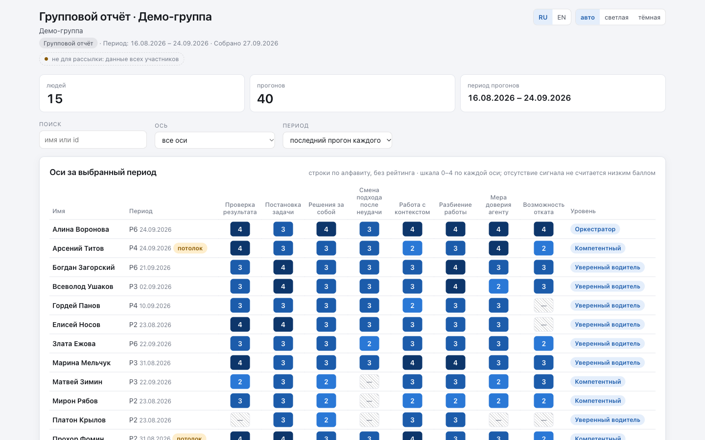
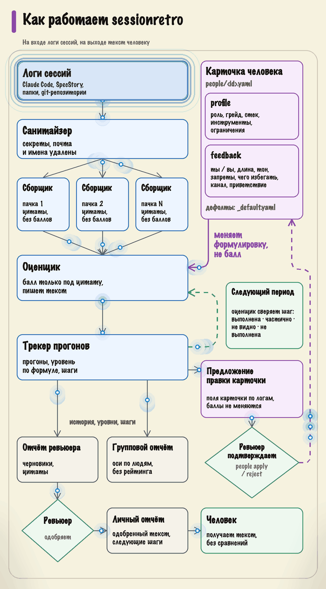
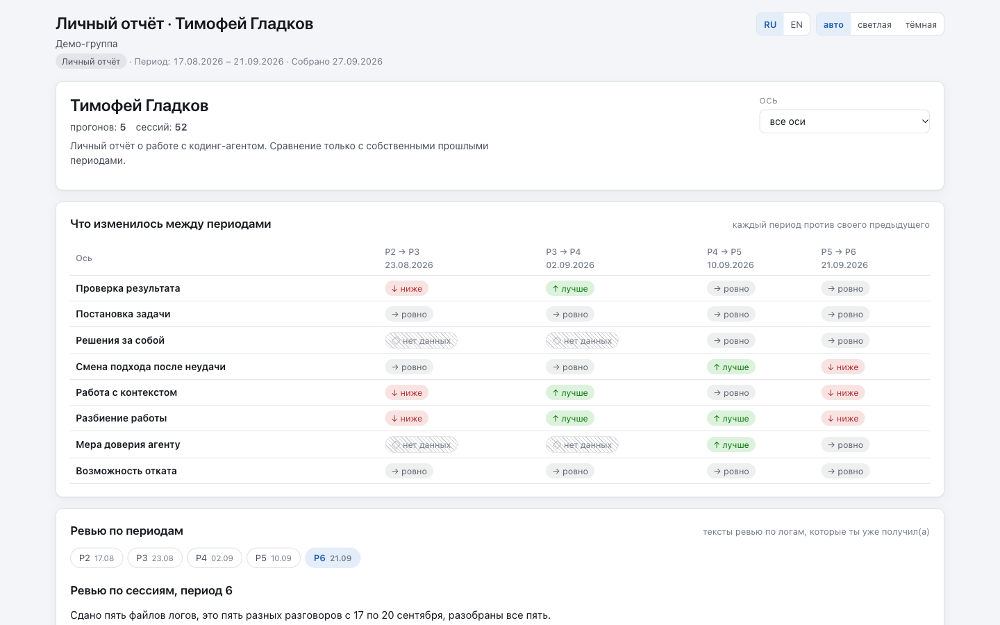

<p align="center"><a href="README.md">English</a> | <a href="README.ru.md">Русский</a></p>

# sessionretro

**Ретро того, как вы работаете с кодинг-агентом. Оценивает процесс, а не код.**

sessionretro — плагин Claude Code, который читает логи ваших сессий с агентом за период и показывает, как вы ведёте агента: ставите задачу, проверяете результат, держите решения за собой. Восемь осей поведения, каждое суждение подкреплено цитатой из лога, один-три конкретных следующих шага и динамика против вашего же прошлого периода.

[](LICENSE)
[](CHANGELOG.md)
[](#быстрый-старт)
[](#быстрый-старт)

<p align="center"></p>

## Быстрый старт

Нужны Claude Code и python3 версии 3.10 или новее (только стандартная библиотека, ставить через `pip` ничего не нужно). SpecStory — по желанию: она нужна только для логов других агентов (Cursor, Codex и других).

В Claude Code:

```text
/plugin marketplace add Serg1kk/sessionretro
/plugin install sessionretro@sessionretro
/sessionretro:setup
```

- Репозиторий пока приватный: нужен доступ к нему и SSH-ключ на GitHub или `gh auth setup-git`, чтобы Claude Code смог его склонировать.
- После установки выполните `/reload-plugins` или откройте новую сессию Claude Code, затем вызовите `/sessionretro:setup`.
- Для разработки плагина: `claude --plugin-dir <путь к plugin>` запускает его из локальной папки без установки.

`setup` задаёт до 11 вопросов по одному и создаёт в проекте workspace `.sessionretro/`. Дальше — собрать логи, запустить ревью, открыть отчёты (разделы ниже).

## Что умеет

- **Собирает и очищает логи сессий**: сессии Claude Code напрямую, другие агенты — через выгрузки SpecStory, папки с логами и git-репозитории. Секреты, почта, логины в домашних путях и имена из вашего списка вычищаются до копирования; исходные логи не меняются никогда.
- **Оценивает восемь осей поведения**: проверка результата, постановка задачи, решения за собой, смена подхода после неудачи, работа с контекстом, разбиение работы, мера доверия агенту, возможность отката. Оценка ставится только под дословную цитату; нет сигнала — «мало данных», а не низкий балл.
- **Пишет личный текст** с одним-тремя следующими шагами: место в логе, чем оно обошлось и конкретное действие. В следующем периоде проверяет, видно ли каждый шаг в новых логах.
- **Показывает динамику** — всегда против вашего же прошлого периода. Людей между собой не сравнивает никогда.
- **Собирает самодостаточные HTML-отчёты**: для ревьюера, для всей группы и личный файл для отправки человеку; открываются в любом браузере без сети.
- **Подстраивается под человека и проект**: карточка человека меняет формулировку, но не оценку; шаблон текста, модели и effort агентов можно поменять.
- **Предлагает правки карточки** по одобренным прогонам: новые инструменты из логов, устойчиво сильные оси в `skip_basics`, расхождения профиля, замеченные оценщиком; карточка не меняется без команды `people apply` ([подробнее](docs/ru/customize.md#карточка-обновляется-по-предложениям)).

## Как работает

<p align="center"></p>

Карточка человека идёт только к оценщику: она меняет формулировку, а не балл. Шаги одного периода оценщик сверяет в следующем, а в режимах team и course текст уходит человеку только после одобрения ревьюера.

<details>
<summary>Текстовая версия</summary>

```text
логи сессий ─▶ санитайзер ─▶ сборщики ─▶ оценщик ─▶ трекер ─▶ HTML-отчёты
                             (пачки,      (оценки    (история,
                              цитаты,      под        уровни,
                              без баллов)  цитатами,  шаги)
                                           текст)
                                            ▲
карточка человека: profile + feedback ──────┘  меняет формулировку, не балл

следующий период: оценщик сверяет каждый шаг ─▶ выполнена · частично · не видно · не выполнена
отчёт ревьюера ─▶ ревьюер одобряет (team, course) ─▶ личный отчёт ─▶ человек
```

</details>

Скрипты собирают логи и очищают их. Агенты-сборщики читают сессии периода пачками параллельно и выписывают дословные цитаты, баллов не ставят; ничего не срезается — пачка это разбиение, а не выборка. Один агент-оценщик сводит факты, ставит оценку по каждой оси только под цитату и пишет текст для человека. Скрипты проверяют результат, записывают прогон, считают уровень по формуле и собирают текст по заменяемому шаблону. Подробно: [docs/ru/how-it-works.md](docs/ru/how-it-works.md).

## Три режима

| Режим | Кто разбирает | Люди | Текст человеку |
|---|---|---|---|
| `self` | вы себя | одна карточка `me` | готов сразу |
| `team` | тимлид или ревьюер — команду | карточка на каждого | уходит только после одобрения ревьюера |
| `course` | преподаватель — учебную группу | карточка на каждого участника | уходит только после одобрения преподавателя |

Один код на все три режима; режим выбирается в `setup` и меняется повторным запуском.

## Настройка

Откройте Claude Code в проекте и вызовите `/sessionretro:setup`: до 11 вопросов по одному (режим, люди, источники логов, хук SessionEnd, модели и effort агентов, баллы, периоды, шаблон, срок хранения логов, `.gitignore`), затем одна команда `sr.py setup-apply` применяет ответы и `doctor` показывает итог. Для скриптов и CI — `setup-apply --answers <файл|->` с JSON.
Проектные агенты `.claude/agents/sessionretro-*.md` можно править, обновление плагина их не трогает; предложения авторам плагина пишутся в `.sessionretro/improvements/` и уходят, только когда вы сами отправите issue.
Подробно: [docs/ru/setup.md](docs/ru/setup.md), [docs/ru/customize.md](docs/ru/customize.md), [docs/ru/feedback.md](docs/ru/feedback.md).

## Сбор логов сессий

`/sessionretro:collect` (или `python3 "${CLAUDE_PLUGIN_ROOT}/scripts/sr.py" collect`) собирает сессии Claude Code (JSONL), выгрузки SpecStory, папки с логами и, в режимах team и course, git-репозитории в очищенные копии в `.sessionretro/logs/` и ведёт перечень сессий со статусами в `.sessionretro/logs-index.json`.
С включённым хуком SessionEnd (`hook.enabled`) сбор идёт в фоне после каждой сессии Claude Code. Claude Code сам удаляет свои логи старше `cleanupPeriodDays` (по умолчанию 30 дней); `setup` предложит поднять срок до 90, а собранные копии остаются в workspace.
На Windows сбор в 0.1 не поддерживается. Подробно: [docs/ru/collect.md](docs/ru/collect.md).

## Как запустить ревью

Попросите Claude Code «провести ретро за период» или вызовите скилл: `/sessionretro:review <person>` или `/sessionretro:review --all`; `--no-ask` — запуск без вопросов (`claude -p`), `--approve <person>` — одобрить черновик. Сборщики читают сессии периода пачками, оценщик ставит оценки под цитаты, скрипты записывают прогон и собирают текст в `.sessionretro/reviews/<person>/<run_id>.md`. В режимах team и course текст остаётся черновиком, пока его не одобрит ревьюер.
Запуск, аргументы и коды выхода: [docs/ru/review.md](docs/ru/review.md); оценка простым языком: [docs/ru/how-it-works.md](docs/ru/how-it-works.md); оси и уровни: [docs/ru/axes.md](docs/ru/axes.md).

## Отчёты

`/sessionretro:report` (или `python3 "${CLAUDE_PLUGIN_ROOT}/scripts/sr.py" report`) собирает самодостаточные HTML-файлы:

- `reports/reviewer.html` — всё для ревьюера: черновики, досье, доказательства, рекомендации, вид «как видит адресат»;
- `reports/group.html` (режимы team и course) — один интерфейс на всю группу: оси по людям в алфавитном порядке, без рейтинга; по клику на человека — его карточка: оси во времени, одобренные тексты ревью по периодам (с вкладкой «все») и рекомендации с вердиктами; `--no-details` или `"report": {"group_details": false}` оставляет только цифры для показа группе;
- `reports/personal/<id>.html` — файл, который отправляют человеку: его карточка, как у ревьюера, без служебного — оси во времени с баллами и уровнем (или только динамика ↑ → ↓ ◇: `--trend`, `show_scores: false`), агенты и модели, рекомендации с вердиктами по периодам и только одобренные тексты ревью;
- `~/.sessionretro/reports/index.html` — все ваши workspace на одной странице.

Личный файл не записывается, если в нём упомянуты другие люди workspace. `--anon` собирает копию с кодами и вымышленными именами для демо. Подробно: [docs/ru/reports.md](docs/ru/reports.md).

<details>
<summary>Личный файл: что получает человек</summary>

<p align="center"></p>

</details>

## Демо

В плагине лежит обезличенный демо-workspace: реальная учебная группа с вымышленными именами, 15 человек, пять периодов, одобренные тексты ревью на русском. Из папки плагина:

```bash
python3 scripts/sr.py --workspace demo/workspace report --group --all-personal --reviewer --out-dir /tmp/sessionretro-demo
```

Затем откройте `group.html`, `reviewer.html` и `personal/*.html` в `/tmp/sessionretro-demo`. Что внутри и как обезличено: [demo/README.md](demo/README.md) (на английском).

## Приватность

- **Всё работает локально.** Скрипты — python на вашей машине; состояние лежит в `.sessionretro/` проекта и в `~/.sessionretro/`. У плагина нет сервера, аккаунта и телеметрии.
- **Вызовы моделей идут через ваш Claude Code.** Сборщик, оценщик и критик — агенты Claude Code в вашей сессии, под вашим аккаунтом и его условиями; они читают очищенные копии, а не исходные логи. Других адресатов для ваших данных плагин не добавляет.
- **Сеть из скриптов** — только `git clone`/`git pull` репозиториев, которые вы указали источниками логов, и `specstory sync`, если SpecStory среди источников.
- **Сначала санитайзер.** Секреты, ключи, почта, телефоны, логины в домашних путях, внутренние адреса и имена из карточек и `sanitize.names` заменяются до копирования лога.
- **Плагин ничего не отправляет.** Отчёты — файлы, которыми вы делитесь сами; предложения авторам — файлы, которые вы сами отправляете как issue.
- **Ограничения.** Санитайзер работает по правилам: имя человека, упомянутого внутри лога, вычищается, только если оно есть в карточке или в `sanitize.names`; название клиента в свободном тексте видите только вы. Перед тем как отдать логи кому-то, пролистайте копию в `.sessionretro/logs/`.

Подробно: [docs/ru/privacy.md](docs/ru/privacy.md).

## Качество и стоимость

Оценщик проверяется на эталонном наборе: 15 реальных сессий с эталонными оценками из прошлых одобренных ревью, два полных прогона — оценщик opus, сборщики sonnet.

- 96–100 % оценок по осям — в пределах ±1 от эталона;
- два прогона расходятся не больше чем на 1 балл по любой оси;
- итоговый уровень совпал с эталоном у 9 сессий из 15.

Честная оговорка: ±1 — слабая планка, когда почти все оценки лежат между 2 и 4, а оценщик склонен тянуть оценки к середине. Читайте цитаты и текст, а не цифры; поэтому же человек по умолчанию баллов не видит.

Стоимость с моделями по умолчанию (оценщик opus, сборщики sonnet): около 2 $ и 5–15 минут на сессию; живой прогон 4 сессий занял около 3,3 $ и 13 минут. Оплачивается через ваш Claude Code. Английский текст оценщика на эталонном наборе ещё не проверялся: референсы осей — на русском.

## Конфигурация

Настройки workspace — в `.sessionretro/config.json`; их пишет `setup`, править можно и руками. Про `reviewer_gate`, `sanitize` и `batches` `setup` не спрашивает: их меняйте только в файле руками (ответ `setup-apply` с этими ключами отклоняется с кодом 2).

| Ключ | По умолчанию | Что меняет |
|---|---|---|
| `mode` | задаётся в `setup` | `self`, `team` или `course` |
| `lang` | язык разговора | `ru` или `en`: тексты и отчёты |
| `sources` | SpecStory + Claude Code этого проекта | откуда брать логи: `claude-jsonl`, `specstory`, `dir`, `git` |
| `hook.enabled` | `true` | фоновый сбор в конце каждой сессии Claude Code |
| `models` | сборщик `sonnet`/`medium`, оценщик `opus`/`high`, критик `sonnet`/`medium` | модель и effort каждого агента |
| `period.mode` | `run` | периоды по дате запуска (`run`) или окнами дат (`dates`); `labels` принимается, но в 0.1 скилл `review` метку не спрашивает и прогоны остаются без метки |
| `show_scores` | `true` | вид личных отчётов: `true` — оси с баллами и уровень, `false` — только динамика ↑ → ↓ ◇; человеку можно задать свой вид `feedback.show_scores` в карточке, запуску — `report --scores`/`--trend` |
| `reviewer_gate` | `true` | в режимах team и course текст — черновик до одобрения; только руками |
| `report.group_details` | `true` (необязательный ключ) | карточка человека с одобренными текстами и рекомендациями в `group.html`; `false` — только цифры |
| `sanitize.names`, `sanitize.extra_patterns` | пусто | свои слова и шаблоны, которые вычищаются из логов |
| `batches.min_turns` | `4` | сессии короче отмечаются «слишком короткими» и не оцениваются |
| `template` | `default` | шаблон текста; своя копия — в `.sessionretro/templates/` |

Как писать каждому человеку — карточка `.sessionretro/people/<id>.yaml` и общий `_default.yaml` ([docs/ru/customize.md](docs/ru/customize.md), [docs/ru/workspace.md](docs/ru/workspace.md)).

## Чем отличается

- `/insights` в Claude Code показывает, где сессия с Claude застряла. sessionretro смотрит на ваш способ работы за период: восемь осей, антипаттерны и изменение против вашего же прошлого периода.
- Трекеры расхода считают токены и деньги; архиваторы сессий вроде SpecStory хранят историю. sessionretro оценивает сам процесс и читает выгрузки SpecStory как один из источников.
- Коучинг на правилах считает шаблоны. Здесь каждое суждение стоит на дословной цитате с номером сессии и хода, а отсутствие сигнала — «мало данных».
- Ревью одной сессии смотрит на последний чат. sessionretro разбирает много сессий периода и в следующем периоде проверяет свои же рекомендации.
- Роли тимлида и преподавателя, одобрение ревьюером до того, как текст дойдёт до человека. Никаких рейтингов и лидербордов.

## Документация

- Все страницы на русском — от настройки до отчётов и частых вопросов: [docs/README.md](docs/README.md).
- Самое нужное: [настройка](docs/ru/setup.md), [сбор логов](docs/ru/collect.md), [восемь осей](docs/ru/axes.md), [отчёты](docs/ru/reports.md), [приватность](docs/ru/privacy.md), [частые вопросы](docs/ru/faq.md).
- На английском: [как устроена оценка](docs/en/how-it-works.md), [приватность](docs/en/privacy.md), [настройка под себя](docs/en/customize.md).

## Планы

0.1 сделана и проверена на Claude Code; логи Cursor, Codex, Antigravity и других агентов собираются через SpecStory, оценка запускается из Claude Code. Дальше — запуск оценки из Codex и Cursor, чтение их файлов сессий, Windows, английские референсы осей. Не делаем никогда: рейтинги людей, аналитику токенов, ревью кода. Подробно: [ROADMAP.md](ROADMAP.md).

## Как помочь

Начните с issue: шаблоны «ошибка», «предложение» и «утечка приватности». Вопросы и идеи — в GitHub Discussions; почты нет. Никогда не вкладывайте логи сессий, имена и ключи. Как прислать pull request, тесты и стиль — [CONTRIBUTING.md](CONTRIBUTING.md); роли и решения — [MAINTAINERS.md](MAINTAINERS.md).

## Лицензия

MIT, см. [LICENSE](LICENSE).
