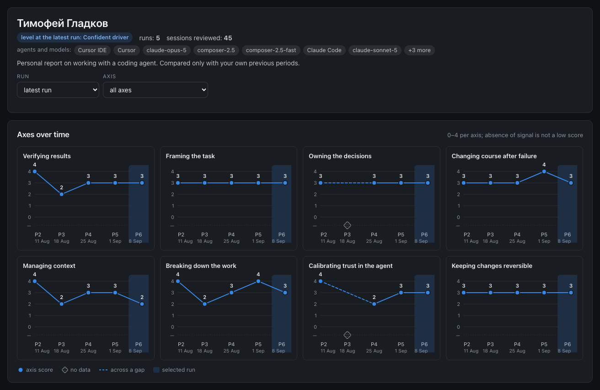

# Reports: what each reader sees

Once a period is assessed, sessionretro builds HTML reports from the results. They are ordinary
files: they open in any browser, work without the internet and send nothing anywhere. All the data
is already inside the file, so the main rule is simple: **each file gets only what its reader is
supposed to see**. Everything else is cut when the file is built, not hidden in the browser.

The screenshots on this page are taken on the anonymized demo workspace that ships with the
plugin; the demo review texts are in Russian, the interface is switched to English.

## How to build

```bash
python3 "${CLAUDE_PLUGIN_ROOT}/scripts/sr.py" report
```

```text
/home/user/work/my-app/.sessionretro/reports/group.html · 84.9 КБ
/home/user/work/my-app/.sessionretro/reports/reviewer.html · 171.2 КБ
/home/user/work/my-app/.sessionretro/reports/personal/alex.html · 87.6 КБ
/home/user/work/my-app/.sessionretro/reports/personal/sam.html · 87.5 КБ
/home/user/.sessionretro/reports/index.html · 4.4 КБ
```

Without flags it builds everything that fits the workspace mode: in `self`, the reviewer report,
your personal report and the page of all workspaces; in `team` and `course`, the group report as
well. Reports are built from the assessment history, so at least one assessment run has to happen
first.

You can rebuild as often as you like: report files are overwritten whole, and the command changes
no other workspace data. Inside Claude Code the `/sessionretro:report` skill does the same.

## Reports and the workspaces page

| File | For whom | What is inside |
|---|---|---|
| `reports/reviewer.html` | the reviewer (in `self` mode, you) | everything: overview, person cards, axes over time, evidence from the logs, anti-patterns, flags, drafts and approved review texts, dossiers, recommendations and their history, card suggestions |
| `reports/group.html` | the reviewer, a team lead, an instructor; shown to the group, not forwarded (`team`, `course`) | approved runs only. Overview: summary numbers, axes per person, the distribution of scores; a click on a person opens their card: axes over time, approved review texts by period and recommendations with verdicts. With `--no-details`, numbers and charts only |
| `reports/personal/<id>.html` | the person | their card as the reviewer sees it, minus the reviewer-only parts: axes over time (with scores and level, or dynamics only ↑ → ↓ ◇), agents and models, recommendations with status and verdicts by period, approved review texts |
| `~/.sessionretro/reports/index.html` | you | all your workspaces with links to their reports |

Dates in the reports are the dates of the period's logs (the "Logs: …" line in the header, the
"log dates" tile, the chart labels), not the day the assessment ran; the reviewer sees the
assessment day in small print in the header of their report. If a period has no log dates, the
assessment date is used and the labels speak of runs.

"Sessions reviewed" counts only the sessions that went into the assessment. Those filtered out
before it (an empty or too short log, a subagent log, a duplicate, another period, excluded ones)
are not in that number. The reviewer sees them separately, as a small "skipped: N" note in the
person card. On the charts a run label like `run-20260927-2` is shown as a period number: the date
under it is the date of the logs, since the run day would only confuse. Long labels are cut with an
ellipsis; the full label is in the tooltip.

### The reviewer report

The working file. Everything is here, including review drafts (marked "draft") and dossiers. This
file is not forwarded: it holds the data of all people. What is inside:

- a "Copy the sent block" button at every review;
- "As the person sees it": switches the card to the personal report view exactly as the person
  will get it, in the same view (with scores or dynamics only, see "Scores and level");
- an "all" tab for review texts: all of a person's texts in a row, each with its period heading
  (a draft is marked).

To keep the file from growing, log quotes (in anti-patterns too), dossiers and feedback drafts are
embedded only for the last three periods of each person. For older periods the report names the
review file `reviews/<id>/<run>.md`, which has everything.

What the reviewer's card looks like next to the personal file of the same person is shown below, in
"Reviewer and person: who sees what".

The person card here also holds the "Card suggestions" block: edits to the person card that the
plugin proposes from approved runs, with ready `people apply` and `people reject` commands (details
in [customize.md](customize.md#the-card-is-updated-through-suggestions)). The block does not get
into the personal file or into `group.html`.

<p align="center"></p>

### The group report

One interface for the whole group: an overview with numbers and a card for every person. People
are listed alphabetically, not by score: there is no ranking, and the plugin offers no way to
compare people with each other. A "not for distribution" badge sits on top: the file holds the data
of all participants, so it is shown, not forwarded. In `self` mode the group report is not built:
there is only one person.

<p align="center"></p>

The overview: a "people × axes" heatmap for the selected period (by default each person's latest
run), filters by name, axis and period, the level and a "capped" badge when the gate fired; below
it, how many people have each score on each axis. A "—" cell means "no data", not zero.

A click on a person opens their card:

- "Axes over time": charts per axis, as before;
- "Feedback by period": a tab per period, each with the sent text of the approved review (the same
  as in the personal report), and an "all" tab with all texts in a row under period headings;
- "Recommendations and what became of them": as in the personal report, status and verdicts by
  period, the verdict explanation in a tooltip (machine paths in it are cut: a path inside
  `.sessionretro/` becomes `logs/<id>/<file>`, any other becomes a file name).

<p align="center"></p>

The "Period" selector in the card: "all periods" is the "all" tab; a specific period opens that
period's tab, and the recommendations issued in it are highlighted with an "issued in the selected
period" note.

The group report holds only approved runs, everywhere: the heatmap, the charts and the card.
Drafts and unapproved runs are seen only by the reviewer, in `reviewer.html`. The card holds only
what the person has already received: approved texts, recommendations and verdicts of approved
runs. Dossiers, service headers, log quotes, anti-patterns, flags and paths are not in it; they
stay in the reviewer report.

The card is on by default. To hide the feedback texts and recommendations from `group.html` and
keep numbers and charts only, turn it off:

- for one run: `sr.py report --group --no-details` (without the `--group` target the flag gives
  code `2`);
- always: `"report": {"group_details": false}` in `.sessionretro/config.json`.

Participants' names are legitimate in the group report, so the names and ids of workspace people
are not searched for in it. Words from `sanitize.names` are always searched for, as in personal
files (see "The guard against other people's names"): if found, `group.html` is not written, the
old one is deleted, code `1`. With `--anon` the card has codes and made-up names, the texts are
anonymized as in personal files, and the file is checked for real names and ids (see `--anon`). A
`feedback.html` file left by earlier versions is deleted with a warning when the group report is
built.

### The personal report

This is the file the person receives. It looks like the person's card in the reviewer report,
without the parts that belong to the reviewer. It has:

- the header: name, how many periods and reviewed sessions, the agents and models the person
  worked with; in the scores view also the level at the latest run;
- a run selector (highlights the run on the charts and opens its review text) and an axis filter;
- "Axes over time": charts per axis with scores 0–4, as in the reviewer's card; or, in the
  "dynamics only" view, the same grid of axes with a transition to each period instead of scores:
  ↑ better, → same, ↓ lower, ◇ no data (the first period says "nothing to compare with");
- the person's recommendations: the period each was issued in and its status (open, followed, not
  followed); under each, the verdicts by period: in which period it was checked and what was seen
  ("P2 ✓ Followed", "P3 ◐ Partly followed"), with the explanation in a tooltip on hover; a
  recommendation not checked yet says "not checked yet". The person sees the explanation as text:
  machine paths in it are reduced to a file name when the file is built (a path inside
  `.sessionretro/` becomes `logs/<id>/<file>`), and the OS login is removed; the reviewer sees the
  explanation as is in their report;
- the review texts the reviewer approved, only the part that is sent; the "all" tab shows them in
  a row under period headings.

<p align="center"></p>

<p align="center"></p>

The verdict explanation opens on hover over its chip:

<p align="center"></p>

The sent part is the block between the first and the second `---` rule after the header of the
review file. The file counts as marked up only if the first line after the header is
`<!-- service -->` (the start of the service block). If that line or the whole service block is
deleted, nothing from that review gets into the personal report, and the build warns "нет маркера
<!-- service -->" (no service marker). This way the dossier does not reach the person if the file's
markup is broken.

Never in a personal report: drafts, the service header and dossier of a review, the "copy" button,
log quotes, the judge's explanations under the charts, the run summary, run warnings,
anti-patterns, flags and the gate, the "reviewer override" mark (the final score is shown), other
people's data and paths to logs. They are absent from the file itself, not only from the screen:
the personal report data is built from a whitelist of fields.

In `team` and `course` modes with `reviewer_gate: true` a personal report is built only from
approved runs: periods, the transitions between them, counters, dates and recommendations of an
unapproved run do not get into the file, and its verdicts do not change the status of
recommendations. In the reviewer report such recommendations are marked "from a draft" and are not
counted as open. If a person has no approved run at all, no personal file is built:
`--all-personal` warns, `--personal` exits with code `1`.

Verdicts in the history come only from approved runs: a verdict from a draft is visible neither in
the history nor in the status.

If an axis had no signal in a period, the report says "no data" and why (for example, "work
happened outside the log"). This is not a low score, and it is not penalised.

### Reviewer and person: who sees what

The same demo participant, the latest period: on the left the reviewer's card, on the right the
personal file (the reviewer gets the same view with the "As the person sees it" button).

<table>
<tr><th>Reviewer: <code>reviewer.html</code></th><th>The person: <code>personal/&lt;id&gt;.html</code></th></tr>
<tr><td></td>
<td></td></tr>
</table>

| Block | Reviewer | Personal file | `group.html` | Why |
|---|:---:|:---:|:---:|---|
| Axes over time (charts) | ✅ | ✅ scores, or ↑ → ↓ ◇ in the trend view | ✅ | the person's own progress |
| Level at the latest run | ✅ | ✅ in the scores view, ❌ in trend | ✅ in the heatmap | same rule as scores |
| Agents and models used | ✅ | ✅ | ❌ | context for the person |
| Approved review texts (the part that is sent) | ✅ | ✅ | ✅ | the person has already received them |
| Recommendations with verdict history | ✅ (plus those from drafts, marked) | ✅ approved runs only | ✅ approved runs only | the follow-up loop |
| The judge's explanations under the charts | ✅ | ❌ | ❌ | working notes of the assessment |
| Run summary ("main thing of the run") | ✅ | ❌ | ❌ | a service line for the reviewer |
| Evidence: quotes by axis with session and turn | ✅ | ❌ | ❌ | raw log excerpts stay with the reviewer |
| Dossier: sessions, files, ids, commands to open a log piece | ✅ | ❌ | ❌ | for answering "where was that?" |
| Anti-patterns, safety flags, gate evidence | ✅ | ❌ | ❌ ("capped" badge only) | labels are for the reviewer, the person gets actions |
| Drafts and unapproved runs | ✅ marked "draft" | ❌ | ❌ (not in the heatmap and charts either) | only the reviewer sees what is not approved yet |
| Service header of the review file, log paths | ✅ | ❌ (machine paths in verdict notes are cut: a path inside the workspace becomes `logs/<id>/<file>`, any other becomes a file name) | ❌ | machine paths and bookkeeping |
| "Reviewer override" mark | ✅ | ❌ (the final score is shown) | ✅ marker | the person sees the result, not the correction |
| Card suggestions | ✅ | ❌ | ❌ | the card is the reviewer's tool |
| Other people's data | ✅ | ❌ never | ✅ (it is the group view) | a personal file is about one person |

## Scores and level

A personal report is built in one of two views:

- **scores** (`scores`, the default): "Axes over time" charts with scores 0–4 and the level at the
  latest run, as in the reviewer's card;
- **dynamics only** (`trend`): the same card, but transitions between periods ↑ → ↓ ◇ instead of
  scores, and no level. Scores and the level are then absent from the file's data too, not only
  from the screen.

<p align="center"></p>

The view is chosen like this; the first one that is set decides:

1. the run flag: `--scores` or `--trend` (old names: `--show-scores` = `--scores`,
   `--hide-scores` = `--trend`); it applies to everyone in this run. Two view flags at once is a
   call error, code `2`;
2. the person card: `show_scores: true` or `false` in the `feedback` section of
   `people/<id>.yaml`, the view for this person (see [the person card](workspace.md#the-person-card));
3. `show_scores` in `.sessionretro/config.json`: `true` (as `setup` creates it) means scores,
   `false` means dynamics only.

When personal reports are built, the `/sessionretro:report` skill asks once "Scores or dynamics
only?" and passes the answer as a flag; with `--no-ask` it does not ask, and the view comes from
the cards and the config.

If a person does not need to see changes since the previous period, set `show_dynamics: false` in
their card (the `feedback` section). Then the dynamics only view of their personal report has no
transitions block; in the scores view the charts stay.

The reviewer report and the overview and charts of the group report always have scores: they are
working files. The feedback and recommendations sections of the group card never have scores or
levels, with any flag.

## How to send a personal file

1. Approve the review text for the period: only approved texts get into the personal report, a
   draft never does, with any flags.
2. Build the reports: `sr.py report`, or for one person only, `sr.py report --personal alex`.
3. Open `reports/reviewer.html`, find the person and press "As the person sees it": this is
   exactly what ends up in their file.
4. Send `reports/personal/alex.html` any way you like: e-mail, a messenger, a shared folder. It is
   one self-contained file; the recipient installs nothing.

The plugin sends nothing by itself. You decide what goes to whom.

## The guard against other people's names

Before writing a personal file, the command checks it for names and ids of other people in this
workspace. You can add your own words that must never get into personal files or the group report
(names of internal projects, colleagues outside the workspace) with the `sanitize.names` list in
`.sessionretro/config.json`. The group report is checked only for these words: participants' names
are legitimate in it.

```json
"sanitize": {"names": ["Project Alpha", "Max"], "extra_patterns": []}
```

If the check finds something, that person's file (or `group.html`) is not written, and the old one
is deleted so that an outdated version is not sent by mistake. The other files are built as usual:

```text
sessionretro: чужие токены в /home/user/work/my-app/.sessionretro/reports/personal/alex.html: sam: Sam → «Sam» — файл не записан; старый файл удалён
```

("other people's tokens in …: the file is not written; the old file is deleted"). The exit code is
`1`. What to do: find the place in this person's approved review or recommendations where someone
else is mentioned, rewrite it without the name and rebuild the report. Namesakes do not get in the
way: the check leaves the recipient's own name alone.

The workspace title (`workspace.title` in `config.json`) is shown in the header of every file, and
the check does not look at it: the word "Demo" in "Demo team" is not taken for the name of a person
"Alex Demo". So do not put names into the title. If it contains words from the cards, the command
writes the files and prints a warning with the ids of those cards, without the names themselves:

```text
предупреждение: workspace title contains name tokens of: sam — заголовок workspace показывается в каждом личном файле и гейтом чужих имён не проверяется; уберите имена из workspace.title в .sessionretro/config.json
```

("warning: … the workspace title is shown in every personal file and is not checked by the name
guard; remove the names from workspace.title").

## `--anon`: show without names

Need an example report for a demo, an article or a question in an issue? Build an anonymized copy
in a separate folder:

```bash
python3 "${CLAUDE_PLUGIN_ROOT}/scripts/sr.py" report --anon --out-dir ~/sessionretro-demo
```

In anonymized files:

- people's ids are replaced with codes `p01`, `p02`, …; if the ids themselves look like codes
  (`p01`, `p02`), the codes get another letter (`x01`, `x02`, …) so that one person's code does
  not match another person's id;
- names are replaced with made-up ones (in the report language);
- e-mails, links to GitHub profiles, `@handles` and home paths are removed from the texts;
- personal files are named by code: `personal/p01.html`; the group report has codes and made-up
  names, and the feedback texts and verdict explanations are anonymized;
- a name word shared by several people (two Annas, people with the same surname) is replaced in
  the texts with `[имя]` ("[name]"), so that one person's words are not attributed to another.

Before writing, every anonymized file is checked again: if a real name or id of anyone in the
workspace is still in it (in a personal file, the recipient's own too), the file is not written,
exit code `1`.

`--out-dir` is needed here so that anonymized files do not land next to the regular ones in
`.sessionretro/reports/`. The page of all workspaces is not anonymized: it is only for you and is
always written to `~/.sessionretro/reports/`.

## The page of all workspaces

`~/.sessionretro/reports/index.html` is built together with the reports (or separately with the
`--index` flag). It lists all workspaces from the registry: title, mode, groups, date of the last
run and links to the built reports. If a report has not been built yet, the page says "not built"
instead of a link; if the project folder is gone, "folder not found". The links lead to
`.sessionretro/reports/` of each project, so reports built with `--out-dir` are not visible here.

When the reviewer report was last built is shown by `doctor` in the `reports_built_at` line.

<p align="center"></p>

## Dark theme

Every report has a theme switch (auto, light, dark) and a language switch (RU, EN); the choice is
remembered in the browser.

<p align="center"> </p>

## Flags

| Flag | What it does |
|---|---|
| `--group` | only the group report (`team`, `course`) |
| `--no-details` | the group report without the person card (no feedback texts and recommendations): numbers and charts only (needs the `--group` target or the default build in `team`/`course`) |
| `--reviewer` | only the reviewer report |
| `--personal <id>` | only one person's personal report |
| `--all-personal` | personal reports of everyone who has runs |
| `--index` | only the page of all workspaces |
| `--anon` | anonymize (see above) |
| `--scores` · `--trend` | the view of personal reports for this run: scores and level · dynamics only ↑ → ↓ ◇ (see "Scores and level"); old names `--show-scores` · `--hide-scores` |
| `--lang ru\|en` | the report language; by default from `config.json`. The file itself has a language switch too |
| `--out-dir <folder>` | where to write instead of `.sessionretro/reports/` (the workspaces page is still written to `~/.sessionretro/reports/`) |
| `--json` | print the list of built files as JSON: kind, person, path, size |
| `--workspace <folder>` | name the project explicitly, as in any command |

Target flags can be combined: `sr.py report --reviewer --personal alex`,
`sr.py report --group --all-personal --out-dir <folder>`. `--personal` and `--all-personal` do not
work together (code `2`), and neither do view flags (`--scores`, `--trend` and their old names).

## Common errors

Messages are printed in Russian in 0.1; the first column shows them as printed.

| Message | What it means and what to do |
|---|---|
| `нет трекера прогонов: файла нет (…)` | no run tracker: there have been no assessments yet; assess a period first |
| `трекер прогонов — битый JSON` or `tracker_version … не поддерживается` | the assessment history file is broken or of an old format; restore it from git |
| `нет прогонов для отчёта` | no runs for a report: all runs are retracted, nothing to build |
| `прогон …: нет карточки человека …` | the history has a person whose card was deleted; put the card back into `people/` |
| `прогон …: score / revision … должно быть …` or `элемент runs[N] трекера не объект` | the history was edited by hand and a field has the wrong type; fix the named field |
| `report --personal: нет карточки человека …` (code `2`) | a typo in the id; the list is `sr.py people list` |
| `report --personal: у человека … нет живых прогонов` | this person has not been assessed yet |
| `в режиме self групповой отчёт не собирается` | in `self` there is one person and no group report; if there were no other targets, code `1` |
| `чужие токены в …` | the guard against other people's names fired, see above |
| `report --no-details относится только к групповому отчёту` (code `2`) | add `--group` or drop `--no-details` |
| `config.json не проходит схему: …report…` | `report` accepts only `group_details: true\|false` |
| `argument --trend: not allowed with argument --scores` (code `2`) | two view flags at once; keep one |
| `карточка не проходит схему: $.feedback.show_scores: …` (code `1`) | `show_scores` in the person card is not `true`/`false`; fix the value or delete the line |

Warnings (`предупреждение: …`) do not stop the build, but they are worth a look:

- `ревью не привязано, …` (review not attached): a review file exists but is not attached to a
  run: the run was replaced by a new revision, it is not in the tracker, the file is not in its
  person's `reviews/<id>/`, or the `person_id` in its header is someone else's; such a review does
  not get into the report. A review of a retracted run gives no warning: retraction is a normal
  action. Such files are only counted, and the reviewer report shows their number in small print
  in the header;
- `нет маркера <!-- service -->` (no service marker): the review file markup is broken, nothing
  from it gets into the personal report (see "The personal report");
- `insufficient_evidence_reason … показывается как other`: the "no data" reason is written as text
  rather than a code; the person will see "other reason";
- `рекомендация … не из списка осей, пропущена`: a recommendation has an unknown axis and does not
  get into the reports;
- `людей без прогонов: N` (people without runs): N people have no assessments yet and are not in
  the reports;
- `уровень взят из …` (level taken from …): the run had no main level field, the fallback was used.

Exit codes: `0` everything is built, `1` the data did not add up or a check fired, `2` a wrong call.

## More

- [Workspace: where sessionretro keeps your data](workspace.md)
- [Customizing: cards, the text template, card suggestions](customize.md)
- [Русская версия](../ru/reports.md)
