# Отчёты: что видит каждый

Когда период оценён, sessionretro собирает из результатов HTML-отчёты. Это обычные файлы:
они открываются в любом браузере, работают без интернета и ничего никуда не отправляют. Все
данные уже лежат внутри файла, поэтому главное правило простое: **в каждый файл попадает
только то, что положено видеть его читателю**. Лишнее отрезается при сборке, а не прячется
в браузере.

## Как собрать

```bash
python3 "${CLAUDE_PLUGIN_ROOT}/scripts/sr.py" report
```

```text
/home/user/work/my-app/.sessionretro/reports/group.html · 84.9 КБ
/home/user/work/my-app/.sessionretro/reports/reviewer.html · 171.2 КБ
/home/user/work/my-app/.sessionretro/reports/personal/alex.html · 87.6 КБ
/home/user/work/my-app/.sessionretro/reports/personal/sam.html · 87.5 КБ
/home/user/.sessionretro/reports/index.html · 4.4 КБ
```

Без флагов собирается всё, что уместно режиму workspace: в `self` — отчёт ревьюера, ваш
личный отчёт и страница всех workspace; в `team` и `course` — ещё и групповой отчёт.
Отчёты строятся по истории оценок, поэтому сначала должен пройти хотя бы один прогон оценки.

Пересобирать можно сколько угодно: файлы отчётов перезаписываются целиком, остальные данные
workspace команда не меняет. Внутри Claude Code то же самое делает скилл `/sessionretro:report`.

## Отчёты и страница workspace

| Файл | Для кого | Что внутри |
|---|---|---|
| `reports/reviewer.html` | ревьюер (в режиме `self` — вы сами) | всё: обзор, карточки людей, оси во времени, доказательства из логов, антипаттерны, флаги, черновики и одобренные тексты ревью, досье, рекомендации и их история |
| `reports/group.html` | ревьюер, тимлид, преподаватель; группе показывают, а не пересылают (`team`, `course`) | только одобренные прогоны. Обзор: сводные цифры, оси по людям, распределение по баллам; по клику на человека — его карточка: оси во времени, одобренные тексты ревью по периодам и рекомендации с вердиктами. С `--no-details` — только цифры и графики |
| `reports/personal/<id>.html` | сам человек | его карточка, как у ревьюера, без служебного: оси во времени (с баллами и уровнем или только динамика ↑ → ↓ ◇), агенты и модели, рекомендации со статусом и вердиктами по периодам, одобренные тексты ревью |
| `~/.sessionretro/reports/index.html` | вы | все ваши workspace со ссылками на их отчёты |

Даты в отчётах — это даты логов периода (в шапке «Логи: …», плитка «период логов», подписи на
графиках), а не день, когда запускали оценку; день оценки ревьюер видит мелко в шапке своего
отчёта («оценка: …»). Если у периода нет дат логов, берётся дата оценки и подписи говорят о прогонах.

«Сессий оценено» считает только сессии, которые вошли в оценку. Отсеянные до неё (пустой или
слишком короткий лог, лог субагента, дубль, другой период, исключённые) в это число не входят.
Ревьюер видит их отдельно, мелкой припиской «отсеяно: N» в карточке человека. На графиках метка
прогона вида `run-20260927-2` подписана номером периода (`№1`, `№2`, …): дата под ней — дата
логов, а день запуска в подписи только путал бы. Длинные метки обрезаются многоточием, полная
метка видна в подсказке.

### Отчёт ревьюера

Рабочий файл. Здесь всё, включая черновики ревью (с пометкой «черновик») и досье. Этот файл
не пересылают: в нём данные всех людей. Что есть внутри:

- кнопка «Скопировать отправляемый блок» у каждого ревью;
- «Как видит адресат» — переключает карточку в вид личного отчёта ровно таким, каким его
  получит человек, в том же виде (с баллами или только динамика, см. «Баллы и уровень»);
- вкладка «все» у текстов ревью — все тексты человека подряд, у каждого заголовок периода
  (черновик помечен).

Чтобы файл не разрастался, цитаты из логов (и в антипаттернах), досье и черновик фидбэка
встроены только за последние три периода каждого человека. Для более старых периодов в отчёте указан файл ревью
`reviews/<id>/<прогон>.md` — там всё целиком.

Как выглядит карточка ревьюера рядом с личным файлом того же человека — ниже, в разделе
«Ревьюер и адресат: кто что видит».

Здесь же, в карточке человека, — блок «Предложения к карточке»: правки карточки, которые плагин
предлагает по одобренным прогонам, с готовыми командами `people apply` и `people reject`
(подробно — [customize.md](customize.md#карточка-обновляется-по-предложениям)). В личный файл и
в `group.html` этот блок не попадает.

<p align="center">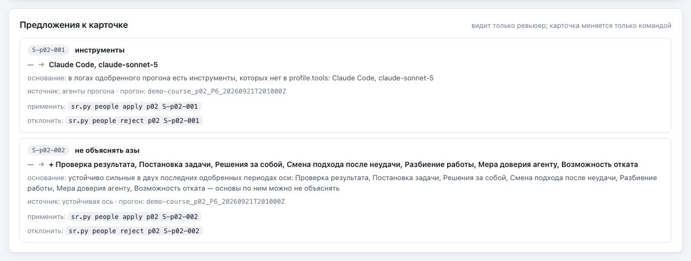</p>

### Групповой отчёт

Один интерфейс на всю группу: обзор с цифрами и карточка каждого человека. Люди идут по
алфавиту, а не по баллам: рейтинга нет, сравнивать людей между собой плагин не предлагает.
Сверху плашка «не для рассылки»: в файле данные всех участников, поэтому его показывают, а не
пересылают. В режиме `self` групповой отчёт не собирается — там один человек.
Групповой отчёт показывает только одобренные прогоны; человек, у которого одобренных ещё нет,
в строках не появляется — он учтён в плитке «ещё нет одобренных».

<p align="center">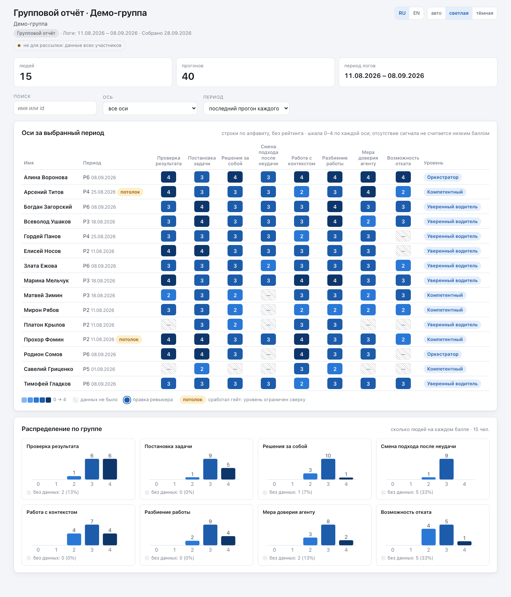</p>

Обзор: теплокарта «люди × оси» за выбранный период (по умолчанию — последний прогон каждого),
фильтры по имени, оси и периоду, уровень и плашка «потолок», если сработал гейт; ниже —
распределение людей по баллам на каждой оси. Клетка «—» — «данных не было», а не ноль.

По клику на человека открывается его карточка:

- «Оси во времени» — графики по осям, как раньше;
- «Фидбэк по периодам» — вкладки периодов, в каждой отправленный текст одобренного ревью (тот
  же, что в личном отчёте), и вкладка «все» — все тексты подряд с заголовком периода;
- «Рекомендации и что с ними стало» — как в личном отчёте: статус и вердикты по периодам,
  пояснение вердикта — в подсказке (пути машины в нём срезаны: путь в `.sessionretro/` — до
  `logs/<id>/<файл>`, прочий — до имени файла).

<p align="center">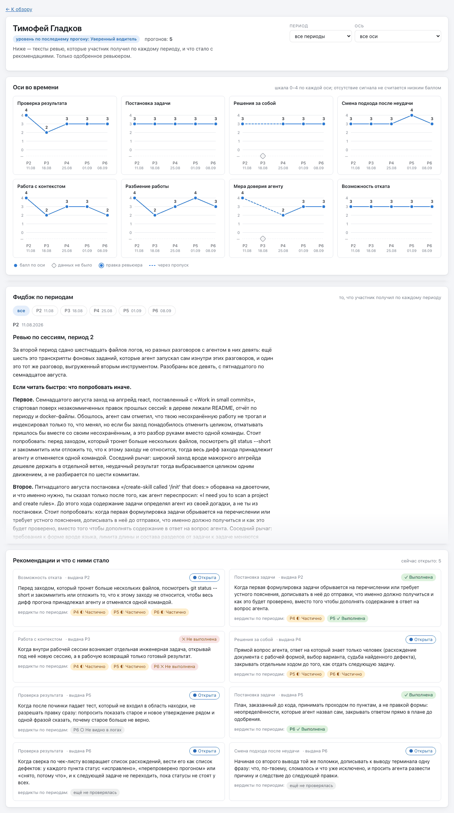</p>

Селектор «Период» в карточке: «все периоды» — вкладка «все»; конкретный период — вкладка этого
периода, а рекомендации, выданные в нём, подсвечены с пометкой «выдана в выбранном периоде».

В групповом отчёте только одобренные прогоны — везде: в теплокарте, на графиках и в карточке.
Черновики и неодобренные прогоны видит только ревьюер, в `reviewer.html`. В карточку попадает
только то, что человек уже получил: одобренные тексты, рекомендации и вердикты одобренных
прогонов. Досье, служебных шапок, цитат из логов, антипаттернов, флагов и путей в ней нет — это
остаётся в отчёте ревьюера.

Карточка включена по умолчанию. Чтобы убрать из `group.html` тексты фидбэка и рекомендации и
оставить только цифры и графики, выключите её:

- на один запуск — `sr.py report --group --no-details` (без цели `--group` флаг даёт код `2`);
- всегда — `"report": {"group_details": false}` в `.sessionretro/config.json`.

Имена участников в групповом отчёте законны, поэтому имена и id людей workspace в нём не
ищутся. Слова из `sanitize.names` ищутся всегда, как в личных файлах (см. «Защита от чужих
имён»): нашлись — `group.html` не пишется, старый удаляется, код `1`. С `--anon` в карточке
коды и вымышленные имена, тексты обезличены так же, как в личных, а файл проверяется на
настоящие имена и id (см. `--anon`). Файл `feedback.html` от прежних версий при сборке
группового отчёта удаляется с предупреждением.

### Личный отчёт

Это файл, который получает человек. Выглядит он как карточка человека в отчёте ревьюера, только
без того, что относится к ревьюеру. В нём:

- шапка: имя, сколько периодов и оценённых сессий, агенты и модели, с которыми он работал; в
  виде с баллами — ещё уровень по последнему прогону;
- выбор прогона (подсвечивает его на графиках и открывает его текст ревью) и фильтр по оси;
- «Оси во времени» — графики по каждой оси с баллами 0–4, как у ревьюера; или, в виде «только
  динамика», та же сетка по осям, но вместо баллов переход к каждому периоду: ↑ лучше, → ровно,
  ↓ ниже, ◇ нет данных (у первого периода — «сравнивать не с чем»);
- его рекомендации: в каком периоде выданы и какой у них статус (открыта, выполнена,
  проигнорирована); под каждой — вердикты по периодам: в каком периоде её проверили и что
  увидели («P2 ✓ выполнена», «P3 ◐ частично»), пояснение — в подсказке при наведении; если
  рекомендацию ещё не проверяли — «ещё не проверялась». Пояснение адресат видит как текст:
  пути машины в нём при сборке сводятся к имени файла (путь в `.sessionretro/` — к
  `logs/<id>/<файл>`), логин ОС вычищается; ревьюер в своём отчёте видит пояснение как есть;
- тексты ревью, которые ревьюер одобрил, — только отправляемая часть; вкладка «все» показывает
  их подряд с заголовком периода.

<p align="center">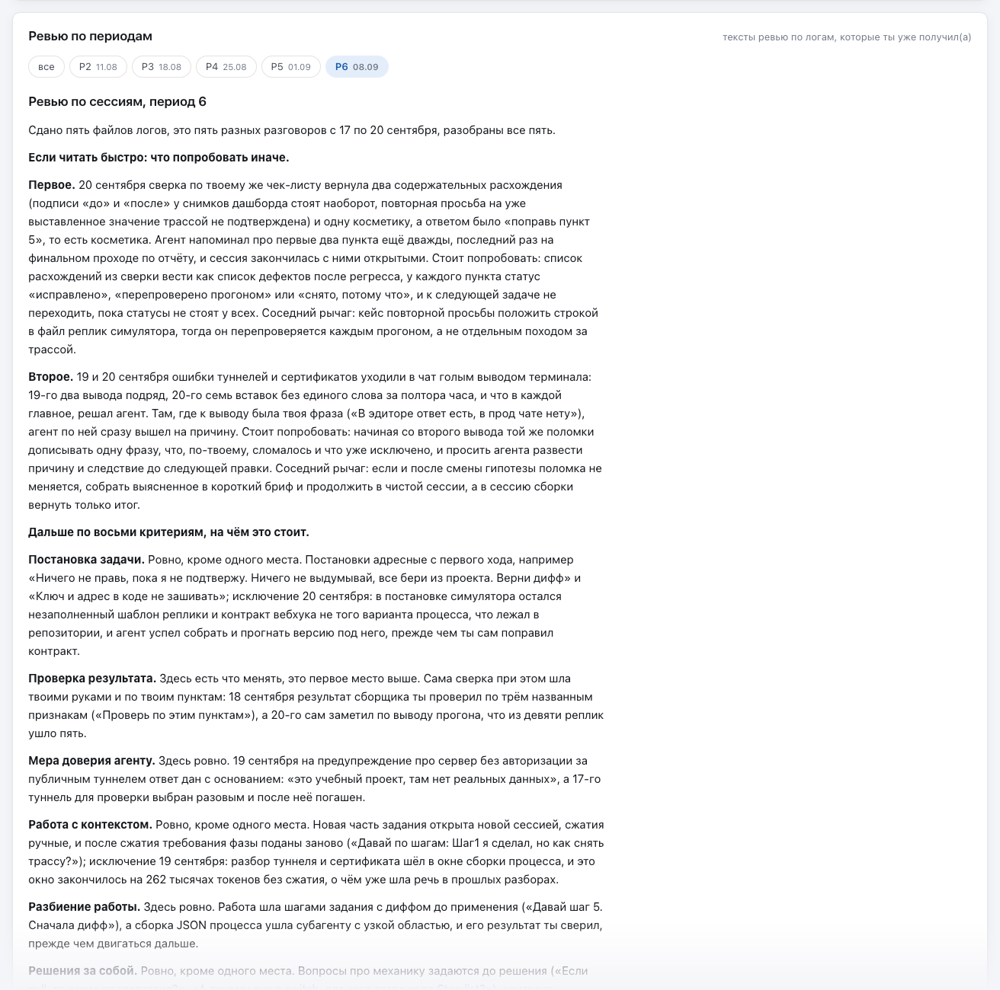</p>

<p align="center">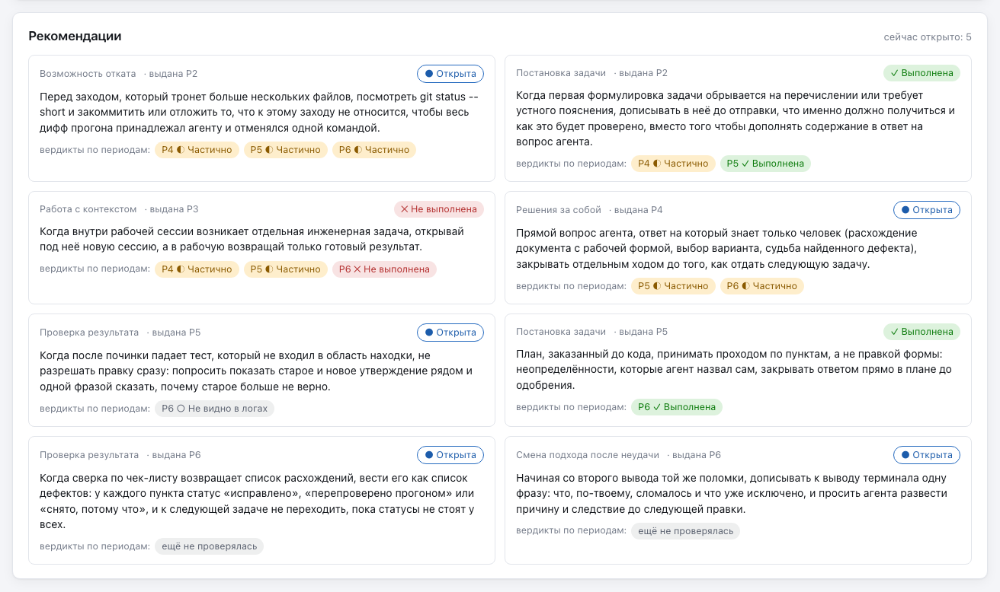</p>

Пояснение вердикта открывается при наведении на его отметку:

<p align="center">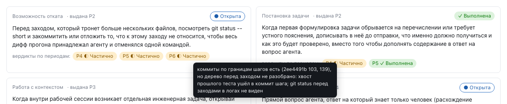</p>

Отправляемая часть — блок между первой и второй линейкой `---` после шапки файла ревью.
Файл считается размеченным, только если первая строка после шапки — `<!-- service -->`
(начало служебного блока). Удалили эту строку или служебный блок целиком — в личный отчёт
из этого ревью не попадёт ничего, а сборка предупредит «нет маркера <!-- service -->».
Так досье не уйдёт адресату, если разметка файла сбилась.

Чего в личном отчёте нет никогда: черновиков, служебной шапки и досье ревью, кнопки
«скопировать», цитат из логов, пояснений оценщика под графиками, «главного по прогону»,
предупреждений прогона, антипаттернов, флагов и гейта, пометки «правка ревьюера» (балл
показывается итоговый), данных других людей и путей к логам. Этого нет в самом файле, а не
только на экране: данные личного отчёта собираются белым списком полей.

В режимах `team` и `course` с `reviewer_gate: true` личный отчёт строится только из
одобренных прогонов: периоды, переходы между ними, счётчики, даты и рекомендации неодобренного
прогона в файл не попадают, а вердикты из него не меняют статус рекомендаций. В отчёте ревьюера
такие рекомендации видны с пометкой «из черновика» и в счётчик открытых не входят. Если у
человека нет ни одного одобренного прогона, личный файл не собирается: `--all-personal`
предупреждает, `--personal` завершается с кодом `1`.

Вердикты в истории — только из одобренных прогонов: вердикт из черновика не виден ни в
истории, ни в статусе.

Если по оси в периоде не нашлось сигнала, в отчёте написано «данных не было» и почему
(например, «работа шла вне лога»). Это не низкий балл, и за это не наказывают.

### Ревьюер и адресат: кто что видит

Один и тот же участник демо, последний период: слева карточка ревьюера, справа его личный файл
(у ревьюера тот же вид — кнопкой «Как видит адресат»).

<table>
<tr><th>Ревьюер: <code>reviewer.html</code></th><th>Человек: <code>personal/&lt;id&gt;.html</code></th></tr>
<tr><td>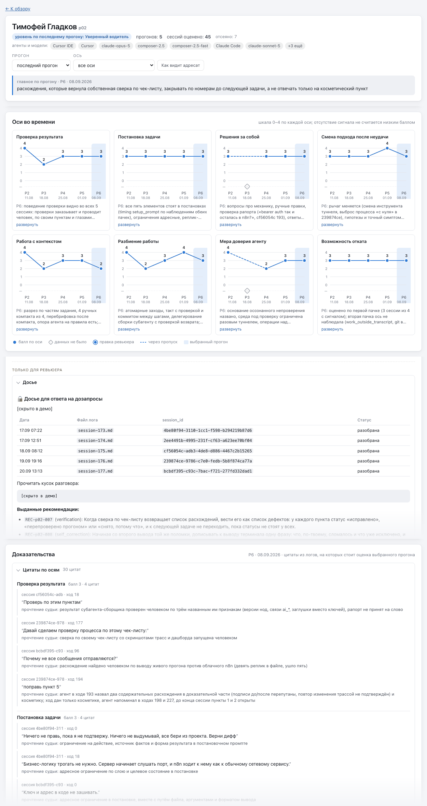</td>
<td>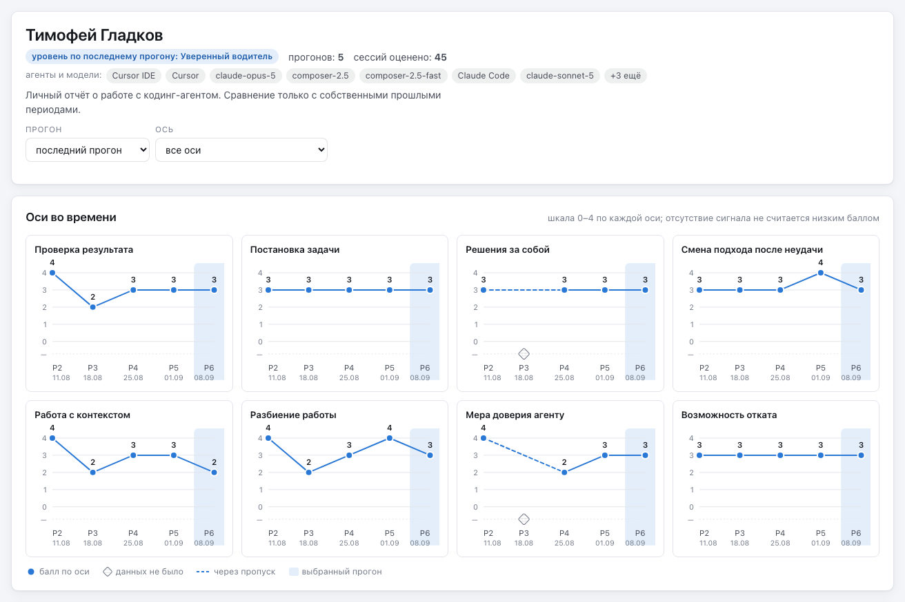</td></tr>
</table>

| Блок | Ревьюер | Личный файл | `group.html` | Почему |
|---|:---:|:---:|:---:|---|
| Оси во времени (графики) | ✅ | ✅ баллы или ↑ → ↓ ◇ в виде «только динамика» | ✅ | собственная динамика человека |
| Уровень по последнему прогону | ✅ | ✅ в виде с баллами, ❌ в «только динамика» | ✅ в теплокарте | то же правило, что для баллов |
| Агенты и модели | ✅ | ✅ | ❌ | контекст для человека |
| Одобренные тексты ревью (отправляемая часть) | ✅ | ✅ | ✅ | человек их уже получил |
| Рекомендации с историей вердиктов | ✅ (и из черновиков, с пометкой) | ✅ только одобренные прогоны | ✅ только одобренные прогоны | петля рекомендаций |
| Пояснения оценщика под графиками | ✅ | ❌ | ❌ | рабочие заметки оценки |
| «Главное по прогону» | ✅ | ❌ | ❌ | служебная строка для ревьюера |
| Доказательства: цитаты по осям с сессией и ходом | ✅ | ❌ | ❌ | сырые куски логов остаются у ревьюера |
| Досье: сессии, файлы, id, команды открыть кусок лога | ✅ | ❌ | ❌ | чтобы ответить на «а где это было?» |
| Антипаттерны, флаги безопасности, доказательства гейта | ✅ | ❌ | ❌ (только плашка «потолок») | ярлыки — ревьюеру, человеку — действия |
| Черновики и неодобренные прогоны | ✅ с пометкой «черновик» | ❌ | ❌ (и в теплокарте, и на графиках) | неодобренное видит только ревьюер |
| Служебная шапка файла ревью, пути к логам | ✅ | ❌ (пути машины в пояснениях вердиктов срезаны: путь внутри workspace — `logs/<id>/<файл>`, прочий — имя файла) | ❌ | пути машины и бухгалтерия |
| Пометка «правка ревьюера» | ✅ | ❌ (показан итоговый балл) | ✅ значок | человек видит результат, а не правку |
| Предложения к карточке | ✅ | ❌ | ❌ | карточка — инструмент ревьюера |
| Данные других людей | ✅ | ❌ никогда | ✅ (это и есть вид группы) | личный файл — про одного человека |

## Баллы и уровень

Личный отчёт собирается в одном из двух видов:

- **с баллами** (`scores`, по умолчанию) — графики «Оси во времени» с баллами 0–4 и уровень по
  последнему прогону, как в карточке ревьюера;
- **только динамика** (`trend`) — та же карточка, но вместо баллов переходы между периодами
  ↑ → ↓ ◇ и без уровня. Баллов и уровня тогда нет и в данных файла, а не только на экране.

<p align="center">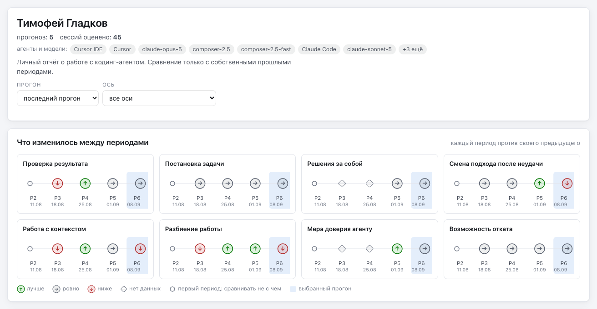</p>

Вид выбирается так, первое заданное решает:

1. флаг запуска: `--scores` или `--trend` (прежние имена: `--show-scores` = `--scores`,
   `--hide-scores` = `--trend`); действует на всех людей этого запуска. Два флага вида сразу —
   ошибка вызова, код `2`;
2. карточка человека: `show_scores: true` или `false` в разделе `feedback` файла
   `people/<id>.yaml` — вид для этого человека (см. [карточку человека](workspace.md#карточка-человека));
3. `show_scores` в `.sessionretro/config.json`: `true` (так создаёт `setup`) — с баллами,
   `false` — только динамика.

Скилл `/sessionretro:report` при сборке личных отчётов один раз спрашивает «Баллы или только
динамика?» и передаёт ответ флагом; с `--no-ask` не спрашивает, вид берётся из карточек и
конфига.

Если человеку не нужно видеть изменения с прошлого периода, поставьте в его карточке
`show_dynamics: false` (раздел `feedback`). Тогда в виде «только динамика» блока с переходами в
его личном отчёте не будет; в виде с баллами графики остаются.

В отчёте ревьюера и в обзоре и графиках группового отчёта баллы есть всегда: это рабочие файлы.
В разделах фидбэка и рекомендаций карточки группы баллов и уровня нет никогда, с любым флагом.

## Как отправить личный файл

1. Одобрите текст ревью за период: в личный отчёт попадают только одобренные тексты,
   черновик туда не попадёт ни при каких флагах.
2. Соберите отчёты: `sr.py report` или только для одного человека —
   `sr.py report --personal alex`.
3. Откройте `reports/reviewer.html`, найдите человека и нажмите «Как видит адресат»:
   это ровно то, что окажется в его файле.
4. Отправьте файл `reports/personal/alex.html` удобным способом: почтой, в мессенджере,
   через общую папку. Это один самодостаточный файл, получателю ничего ставить не нужно.

Плагин сам ничего не отправляет. Что и кому уходит, решаете вы.

## Защита от чужих имён

Перед тем как записать личный файл, команда проверяет, нет ли в нём имён и id других людей
этого workspace. Туда же можно добавить свои слова, которые никогда не должны попадать в
личные файлы и групповой отчёт (названия внутренних проектов, имена коллег вне workspace), —
списком `sanitize.names` в `.sessionretro/config.json`. Групповой отчёт проверяется только на
эти слова: имена участников в нём законны.

```json
"sanitize": {"names": ["Проект Альфа", "Максим"], "extra_patterns": []}
```

Если проверка что-то нашла, файл этого человека (или `group.html`) не записывается, а старый удаляется, чтобы
по ошибке не отправить устаревшую версию. Остальные файлы собираются как обычно:

```text
sessionretro: чужие токены в /home/user/work/my-app/.sessionretro/reports/personal/alex.html: sam: Sam → «Sam» — файл не записан; старый файл удалён
```

Код выхода в этом случае `1`. Что делать: найдите в одобренном ревью или в рекомендациях
этого человека место, где упомянут другой, перепишите его без имени и пересоберите отчёт.
Тёзки не мешают: имя самого адресата проверка не трогает.

Заголовок workspace (`workspace.title` в `config.json`) показывается в шапке каждого файла, а
проверка его не смотрит: слово «Demo» в «Demo team» не считается именем человека «Alex Demo».
Поэтому не вписывайте в заголовок имена. Если в нём есть слова из карточек, команда пишет файлы
и печатает предупреждение с id этих карточек, без самих имён:

```text
предупреждение: workspace title contains name tokens of: sam — заголовок workspace показывается в каждом личном файле и гейтом чужих имён не проверяется; уберите имена из workspace.title в .sessionretro/config.json
```

## `--anon` — показать без имён

Нужен пример отчёта для демо, статьи или вопроса в issue — соберите обезличенную копию в
отдельную папку:

```bash
python3 "${CLAUDE_PLUGIN_ROOT}/scripts/sr.py" report --anon --out-dir ~/sessionretro-demo
```

В обезличенных файлах:

- id людей заменены кодами `p01`, `p02`, …; если id сами похожи на код (`p01`, `p02`), коды
  получат другую букву (`x01`, `x02`, …), чтобы код одного человека не совпал с id другого;
- имена заменены вымышленными (на языке отчёта);
- из текстов убраны e-mail, ссылки на GitHub-профили, `@хэндлы` и домашние пути;
- личные файлы называются по коду: `personal/p01.html`; в групповом отчёте — коды и
  вымышленные имена, тексты фидбэка и пояснения вердиктов обезличены;
- слово имени, общее у нескольких людей (две Анны, однофамильцы), в текстах заменено на
  `[имя]`, чтобы реплику одного не приписать другому.

Перед записью каждый обезличенный файл проверяется ещё раз: если в нём осталось настоящее
имя или id кого-то из workspace (в личном файле — и самого адресата), файл не записывается,
код выхода `1`.

`--out-dir` здесь нужен, чтобы обезличенные файлы не легли рядом с обычными в
`.sessionretro/reports/`. Страница всех workspace не обезличивается: она только для вас и
всегда пишется в `~/.sessionretro/reports/`.

## Страница всех workspace

`~/.sessionretro/reports/index.html` собирается вместе с отчётами (или отдельно — флагом
`--index`). На ней все workspace из реестра: название, режим, группы, дата последнего
прогона и ссылки на собранные отчёты. Если отчёт ещё не собирали, вместо ссылки написано
«не собран»; если папки проекта больше нет — «папка не найдена». Ссылки ведут в
`.sessionretro/reports/` каждого проекта, поэтому отчёты, собранные с `--out-dir`, здесь не
видны.

Когда последний раз собирался отчёт ревьюера, показывает `doctor` строкой `reports_built_at`.

<p align="center">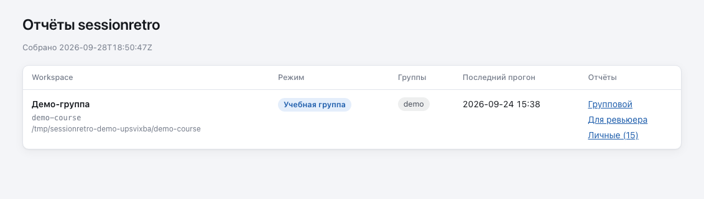</p>

## Тёмная тема

В каждом отчёте есть переключатель темы («авто», светлая, тёмная) и языка (RU, EN); выбор
запоминается в браузере.

<p align="center">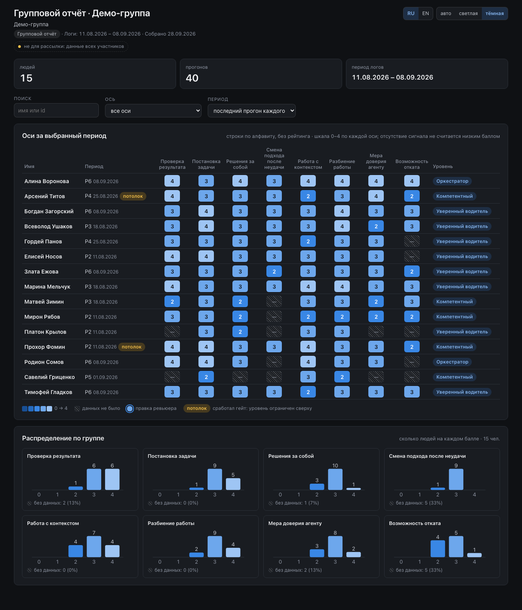 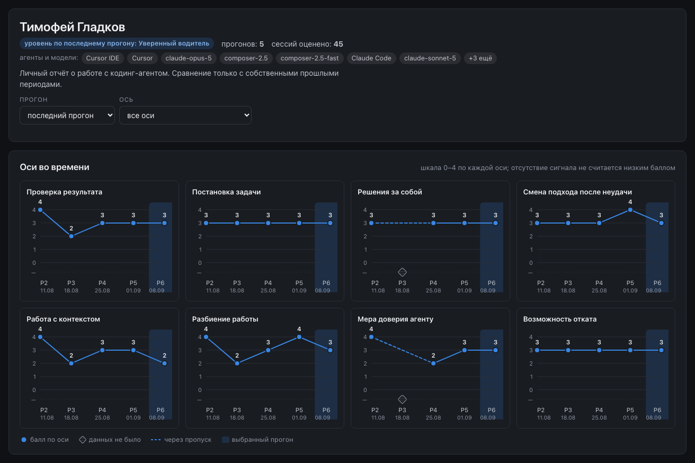</p>

## Флаги

| Флаг | Что делает |
|---|---|
| `--group` | только групповой отчёт (`team`, `course`) |
| `--no-details` | групповой отчёт без карточки человека (без текстов фидбэка и рекомендаций): только цифры и графики (нужна цель `--group` или сборка по умолчанию в `team`/`course`) |
| `--reviewer` | только отчёт ревьюера |
| `--personal <id>` | только личный отчёт одного человека |
| `--all-personal` | личные отчёты всех, у кого есть прогоны |
| `--index` | только страница всех workspace |
| `--anon` | обезличить (см. выше) |
| `--scores` · `--trend` | вид личных отчётов на этот запуск: с баллами и уровнем · только динамика ↑ → ↓ ◇ (см. «Баллы и уровень»); прежние имена — `--show-scores` · `--hide-scores` |
| `--lang ru\|en` | язык отчёта; по умолчанию из `config.json`. Переключатель языка есть и в самом файле |
| `--out-dir <папка>` | куда писать вместо `.sessionretro/reports/` (страница workspace всё равно пишется в `~/.sessionretro/reports/`) |
| `--json` | вывести список собранных файлов в JSON: вид, человек, путь, размер |
| `--workspace <папка>` | указать проект явно, как в любой команде |

Флаги целей можно сочетать: `sr.py report --reviewer --personal alex`,
`sr.py report --group --all-personal --out-dir <папка>`. `--personal` и
`--all-personal` вместе не работают (код `2`), флаги вида (`--scores`, `--trend` и их прежние
имена) — тоже.

## Частые ошибки

| Сообщение | Что значит и что делать |
|---|---|
| `нет трекера прогонов: файла нет (…)` | оценок ещё не было: сначала проведите оценку периода |
| `трекер прогонов — битый JSON` или `tracker_version … не поддерживается` | файл истории оценок повреждён или старого формата; восстановите его из git |
| `нет прогонов для отчёта` | все прогоны отозваны, строить нечего |
| `прогон …: нет карточки человека …` | в истории оценок есть человек, чью карточку удалили; верните карточку в `people/` |
| `прогон …: score / revision … должно быть …` или `элемент runs[N] трекера не объект` | история оценок правилась руками и в поле не тот тип; исправьте указанное поле |
| `report --personal: нет карточки человека …` (код `2`) | опечатка в id; список — `sr.py people list` |
| `report --personal: у человека … нет живых прогонов` | этого человека ещё не оценивали |
| `в режиме self групповой отчёт не собирается` | в `self` один человек, групповой отчёт не нужен; если других целей не было — код `1` |
| `чужие токены в …` | сработала защита от чужих имён, см. выше |
| `report --no-details относится только к групповому отчёту` (код `2`) | добавьте `--group` или уберите `--no-details` |
| `config.json не проходит схему: …report…` | в `report` допускается только `group_details: true\|false` |
| `argument --trend: not allowed with argument --scores` (код `2`) | два флага вида сразу; оставьте один |
| `карточка не проходит схему: $.feedback.show_scores: …` (код `1`) | в карточке человека `show_scores` не `true`/`false`; исправьте значение или удалите строку |

Предупреждения (`предупреждение: …`) не останавливают сборку, но на них стоит взглянуть:

- `ревью не привязано, …` — файл ревью есть, но к прогону не прикреплён: прогон заменён
  новой ревизией, его нет в трекере, файл лежит не в `reviews/<id>/` своего человека или
  `person_id` в шапке чужой; в отчёт такое ревью не попадает. Ревью отозванного прогона
  предупреждения не даёт: отзыв — штатное действие. Такие файлы только считаются, и отчёт
  ревьюера показывает их число мелко в шапке («ревью отозванных прогонов: N»);
- `нет маркера <!-- service -->` — разметка файла ревью сбилась, в личный отчёт из него
  ничего не попадёт (см. «Личный отчёт»);
- `insufficient_evidence_reason … показывается как other` — причина «данных нет» записана
  не кодом, а текстом; адресат увидит «другая причина»;
- `рекомендация … не из списка осей, пропущена` — у рекомендации неизвестная ось, в отчёты
  она не попадает;
- `людей без прогонов: N` — у N человек ещё нет оценок, в отчётах их нет;
- `уровень взят из …` — у прогона не было основного поля уровня, взято запасное.

Коды выхода: `0` — всё собрано, `1` — данные не сошлись или сработала проверка, `2` —
неверный вызов.

## Подробнее

- [Workspace: где sessionretro хранит ваши данные](workspace.md)
- [Настройка под себя: карточки, шаблон, предложения правок карточки](customize.md)
- [English version](../en/reports.md)
